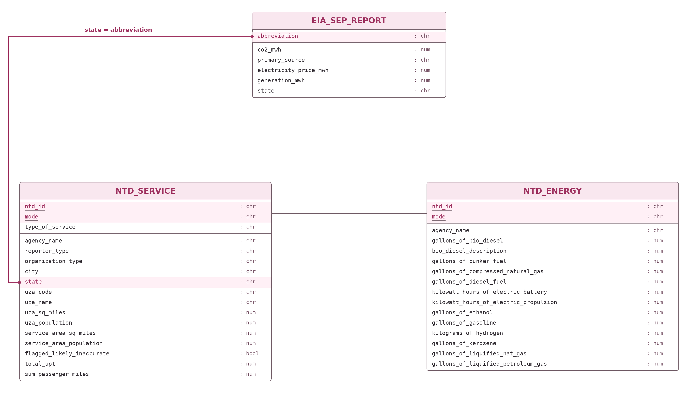

---
  title: "STA 9750 Mini-Project #02: Identifying Environmentally Responsible US Public Transit Systems"
  author: "Kelly Kim"
  date: "2026-11-06"
  engine: knitr
  format:
    html:
      code-tools: true
      toc: true
---
  
# Identifying Environmentally Responsible US Public Transit Systems
The Green Transit Alliance (GTA) estimates the effective emissions reductions achieved by each agency, using a combination of:

- Local ridership data (both number and distance); and
- Emissions estimates of public transit vehicles (either direct tailpipe emissions or upstream emissions from electrical generation)

By comparing these to the tailpipe emissions that would have occurred if all riders had instead driven to their destination, the VI identifies the most valuable public transit agencies in the country.

In this report, we'll walk through the key statistics that lead the the selection for the winners of the various GTA awards.

## Context
There are three datasets: 

1. State level electricity-emissions data which maps how much CO₂ is produced from electricity from each state
2. Transit energy-use data which shows how much fuel and/or electricity each transit agency uses for public transportation.
3. Transit passenger-service data gives the number of passenger trips and passenger miles each transit agency provides.

This report uses these datasets to connect transit agencies’ energy consumption with passenger service and state-level electricity emissions. This allows us to examine how these components intertwine with one another and reveal broader patterns. For example, an agency serving more passengers may burn more fuel and produce more total CO2, but it may  be more efficient than an agency that produces less total CO2 while serving proportionally fewer passengers.


## Task 1a

##Data Acquisition - State Electricity Profiles

The following code will parse the EIA SEP summary pages and create a “tidy” table 

``` {r}
#| label: State Electricity Data Acquisition
#| code-fold: true
#| code-summary: "Loading EIA-SEP Data into R"
#| message: false
#| warning: false

# Load all packages
library(tidyverse)
library(stringr)
library(httr2)
library(rvest)
library(sf)
library(maps)
library(ggplot2)
library(ggiraph)
library(glue)
library(dplyr)
library(forcats)
library(scales)
library(skimr)
library(gt)

get_eia_sep <- function(state, abbr){
  
    state_formatted <- str_to_lower(state) |> str_replace_all("\\s", "")
    
    dir_name <- fs::path("data", "mp02")
    file_name <- fs::path(dir_name, state_formatted)
    
    fs::dir_create(dir_name, recurse=TRUE)
    
    if(!fs::file_exists(file_name)){
        BASE_URL <- "https://www.eia.gov"
        RESPONSE <- request(BASE_URL) |> 
          req_url_path("electricity", 
                       "state", 
                       state_formatted) |>
          req_headers(
            `User-Agent` = "Mozilla/5.0 (Macintosh; Intel Mac OS X 10.15; rv:149.0) Gecko/20100101 Firefox/149.0"
            ) |>   
          req_retry(
                max_tries = 4, 
          ) |>
          req_perform(file_name)
    
        resp_check_status(RESPONSE)
    }
    
    TABLE <- read_html(file_name) |> 
        html_element("table") |> 
        html_table() |>
        mutate(Item = str_to_lower(Item))
    
    if("U.S. rank" %in% colnames(TABLE)){
        TABLE <- TABLE |> rename(Rank = `U.S. rank`)
    }
    
    CO2_MWh <- TABLE |> 
        filter(Item == "carbon dioxide (lbs/mwh)") |>
        pull(Value) |> 
        str_replace_all(",", "") |>
        as.numeric()
    
    PRIMARY <- TABLE |> 
        filter(Item == "primary energy source") |> 
        pull(Rank)
    
    RATE <- TABLE |>
        filter(Item == "average retail price (cents/kwh)") |>
        pull(Value) |>
        as.numeric()
    
    GENERATION_MWh <- TABLE |>
        filter(Item == "net generation (megawatthours)") |>
        pull(Value) |>
        str_replace_all(",", "") |>
        as.numeric()
    
    data.frame(CO2_MWh               = CO2_MWh, 
               primary_source        = PRIMARY,
               electricity_price_MWh = RATE * 10, # / 100 cents to dollars &
               # * 1000 kWh to MWH 
               generation_MWh        = GENERATION_MWh, 
               state                 = state, 
               abbreviation          = abbr
    )
}

EIA_SEP_REPORT <- map2(state.name, state.abb, get_eia_sep) |> list_rbind()

```

The State Energy Profiles dataset is organized at the state level, with `{r} nrow(EIA_SEP_REPORT)` total rows - one per each state in the US. It shows the amount each state's electricity, its respective price, and state-wide generation capacity. We will use this data to compare the emissions of different transit modalities. 

We next turn to the National Transit Database to get information on various public transit authorities.

## Data Acquisition - Energy Consumption

Next, we download the [2025 Annual Database Energy Consumption](https://www.transit.dot.gov/ntd/data-product/2025-annual-database-energy-consumption) report.

``` {r}
#| label: Energy Consumption Data Acquisition
#| code-fold: true
#| code-summary: "Loading Energy Consumption Data into R"
#| message: false
#| warning: false

load_ntd_energy <- function(){
  library(readxl)
  library(httr2)
  library(tidyverse)
  library(fs)
  
  # Create 'data/mp02' directory if not already present
  DATA_DIR <- fs::path("data", "mp02")
  fs::dir_create(DATA_DIR, recurse=TRUE)

  NTD_ENERGY_FILE <- fs::path(DATA_DIR, "2025_ntd_energy.xlsx")

  if(!fs::file_exists(NTD_ENERGY_FILE)){
    library(httr2)
  
    request("https://www.transit.dot.gov/") |>
      req_url_path("sites",
                   "fta.dot.gov",
                   "files",
                   "2026-09",
                   "2025 Energy Consumption_260806.xlsx") |> 
      req_headers(
        `User-Agent` = "Mozilla/5.0 (Macintosh; Intel Mac OS X 10.15; rv:149.0) Gecko/20100101 Firefox/149.0") |> 
      req_perform(NTD_ENERGY_FILE)
  }
  
  if(file.info(NTD_ENERGY_FILE)$size < 1e4){
        cat("I was unable to download the NTD Energy File. Please try again.\n")
        stop("Download failed. Please delete the corrupted file by running `unlink('data/mp02/2025_ntd_energy.xlsx')` and try again.")
    }

  to_numeric_fill_0 <- function(x){
    x <- if_else(x == "-", NA, x)
    replace_na(as.numeric(x), 0)
  }

  read_excel(NTD_ENERGY_FILE) |> 
    select(-c(`Reporter Type`, 
              `Reporting Module`, 
              `Gallons of Other Fuel`, 
              `Other Fuel Description`)) |>
    mutate(across(-c(`Agency Name`, 
                     `Mode`,
                     `TOS`), 
                  to_numeric_fill_0)) |>
    group_by(`NTD ID`, `Mode`, `Agency Name`) |>
    summarize(across(where(is.numeric), sum), 
              .groups = "keep") |>
    mutate(ENERGY = sum(c_across(c(where(is.numeric))))) |>
    filter(ENERGY > 0) |>
    select(-ENERGY) |>
    ungroup()
}

NTD_ENERGY <- load_ntd_energy()

```

Here, the first 3 columns (NTD ID, Mode, and Agency Name) identify the operating agency and the relevant mode of transportation while the remaining columns denote how much of each type of fuel that agency used during 2023. The non-electric sources are all quoted in gallons, while Electric Battery and Electric Propulsion are quoted in kWh used.

The Mode column is important: it is used to distinguish multiple transport types operated the same agency, e.g. MTA subways and buses in NYC. The two letter codes used by the NTD, however, are not immediately interpretable.

## Data Acquisition - Transit Service Provided

Next, we download the [2025 Service by Agency](https://www.transit.dot.gov/ntd/data-product/2025-service) report, from which we will extract characteristics of typical passenger trips on each transit service.

``` {r}
#| label: Transit Service Data Acquisition
#| code-fold: true
#| code-summary: "Loading Transit Service Data into R"
#| message: false
#| warning: false

load_ntd_service <- function(){
  library(httr2)
  library(tidyverse)
  library(fs)
  
  # Create 'data/mp02' directory if not already present
  DATA_DIR <- fs::path("data", "mp02")
  fs::dir_create(DATA_DIR, recurse=TRUE)

  NTD_SERVICE_FILE <- fs::path(DATA_DIR, "2025_ntd_service.csv")

  if(!fs::file_exists(NTD_SERVICE_FILE)){
    library(httr2)
  
    request("https://data.transportation.gov/resource/4fir-qbim.csv") |>
      req_url_query(`$query`=paste(
        "SELECT  `_5_digit_ntd_id` AS `NTD_ID`", 
        "`max_agency` AS `AGENCY`",
        "`max_reporter_type` AS `reporter_type`",
        "`max_organization_type` AS `organization_type`",
        "`max_city` AS `city`",
        "`max_state` AS `state`",
        "`mode`",
        "`type_of_service`",
        "`max_primary_uza_code` as `uza_code`",
        "`max_primary_uza_name` as `uza_name`",
        "`max_primary_uza_area_sq_miles` as `uza_sq_miles`",
        "`max_primary_uza_population` as `uza_population`",
        "`max_service_area_sq_miles` as `service_area_sq_miles`",
        "`max_service_area_population` as `service_area_population`",
        "`questionable_record` as `flagged_likely_inaccurate`",
        "`sum_unlinked_passenger_trips_upt` as `total_upt`",
        "`sum_passenger_miles` WHERE caseless_one_of(`report_year`, '2025') limit 50000", 
        sep=",")) |>
      req_headers(
        `User-Agent` = "Mozilla/5.0 (Macintosh; Intel Mac OS X 10.15; rv:149.0) Gecko/20100101 Firefox/149.0") |> 
      req_perform(NTD_SERVICE_FILE)
  }
  
  if(file.info(NTD_SERVICE_FILE)$size < 1e4){
        cat("I was unable to download the NTD Service File. Please try again.\n")
        stop("Download failed. Please delete the corrupted file by running `unlink('data/mp02/2025_ntd_service.xlsx')` and try again.")
    }

  read_csv(NTD_SERVICE_FILE) |>
    mutate(flagged_likely_inaccurate = !is.na(flagged_likely_inaccurate))
}

NTD_SERVICE <- load_ntd_service()

```

Here UPT is the number of total Unlinked Passenger Trips during 2025; that is, the number of distinct (non-transfer) trips taken

# Data Cleaning and Preparation

## Task 2 — Data checks and recoding the Mode column

Now that we've loaded in all our data, we want to ensure that our column names are valid R variable names and easily typed. This means that we want:

* Only numbers and simple letters, no punctuation or accents
* Starting with a letter
* All lower-case
* If multi-word, separated by underscores (_) not spaces

```{r} 
#| label: Data Cleaning and Preparation
#| code-fold: true
#| code-summary: "Data Cleaning and Preparation"
#| message: false
#| warning: false
#| results: hide


library(skimr)

library(tidyverse)

# Use lowercase, underscore-separated names that are easy to use

NTD_ENERGY <- NTD_ENERGY |>
  rename(
    ntd_id = `NTD ID`,
    mode = Mode,
    agency_name = `Agency Name`,
    gallons_of_bio_diesel = `Gallons of Bio-Diesel`,
    bio_diesel_description = `Bio-Diesel Description`,
    gallons_of_bunker_fuel = `Gallons of Bunker Fuel`,
    gallons_of_compressed_natural_gas =
      `Gallons of Compressed Natural Gas`,
    gallons_of_diesel_fuel = `Gallons of Diesel Fuel`,
    kilowatt_hours_of_electric_battery =
      `Kilowatt hours of Electric Battery`,
    kilowatt_hours_of_electric_propulsion =
      `Kilowatt hours of Electric Propulsion`,
    gallons_of_ethanol = `Gallons of Ethanol`,
    gallons_of_gasoline = `Gallons of Gasoline`,
    kilograms_of_hydrogen = `Kilograms of Hydrogen`,
    gallons_of_kerosene = `Gallons of Kerosene`,
    gallons_of_liquified_nat_gas =
      `Gallons of Liquified Nat Gas`,
    gallons_of_liquified_petroleum_gas =
      `Gallons of Liquified Petroleum Gas`
  )

# Standardize the remaining EIA measurement names to lowercase.
EIA_SEP_REPORT <- EIA_SEP_REPORT |>
  rename(
    co2_mwh = CO2_MWh,
    electricity_price_mwh = electricity_price_MWh,
    generation_mwh = generation_MWh
  )


# Standardize NTD_ID identifier as five-character text values so the two NTD tables match.

# Store agency IDs as consistent five-character text values.
NTD_ENERGY <- NTD_ENERGY |>
  mutate(
    ntd_id = str_pad(
      as.character(ntd_id),
      width = 5,
      pad = "0"
    )
  )

# Standardize service-table identifiers and agency names.
NTD_SERVICE <- NTD_SERVICE |>
  rename(
    ntd_id = NTD_ID,
    agency_name = AGENCY
  ) |>
  mutate(
    ntd_id = str_pad(
      as.character(ntd_id),
      width = 5,
      pad = "0"
    )
  )

# Confirm that column names begin with a lowercase letter and contain only
# lowercase letters, numbers, and underscores.
valid_name_pattern <- "^[a-z][a-z0-9_]*$"

stopifnot(
  all(str_detect(names(NTD_ENERGY), valid_name_pattern)),
  all(str_detect(names(NTD_SERVICE), valid_name_pattern)),
  all(str_detect(names(EIA_SEP_REPORT), valid_name_pattern))
)


# Identify all columns containing fuel or electricity usage.
fuel_columns <- names(NTD_ENERGY)[
  str_detect(
    names(NTD_ENERGY),
    "^(gallons_of|kilowatt_hours|kilograms_of)"
  )
]

# Keep gallon-based fuels separate because their emissions
# factors are expressed per gallon.
gallon_columns <- fuel_columns[
  str_starts(fuel_columns, "gallons_of")
]


# # Confirm that cleaning produced the expected column types.
# glimpse(NTD_ENERGY)
# glimpse(NTD_SERVICE)
# glimpse(EIA_SEP_REPORT)
# 
# # Review numeric distributions after cleaning.
# summary(NTD_ENERGY)
# summary(NTD_SERVICE)
# summary(EIA_SEP_REPORT)


#Validate cleaned values
stopifnot(
  # The EIA table should contain one unique row per state.
  nrow(EIA_SEP_REPORT) == 50,
  !anyDuplicated(EIA_SEP_REPORT$abbreviation),

  # Agency IDs should be five-character text values.
  is.character(NTD_ENERGY$ntd_id),
  is.character(NTD_SERVICE$ntd_id),
  all(str_length(NTD_ENERGY$ntd_id) == 5),
  all(str_length(NTD_SERVICE$ntd_id) == 5),

  # Each energy row should represent one agency and mode pair.
  !anyDuplicated(
    NTD_ENERGY[c("ntd_id", "mode")]
  ),

  # Service type is part of the unique key in the service table.
  !anyDuplicated(
    NTD_SERVICE[c("ntd_id", "mode", "type_of_service")]
  ),

  # Every fuel-use column should contain numeric values.
  all(
    map_lgl(
      NTD_ENERGY[fuel_columns],
      is.numeric
    )
  ),

  # Fuel values should be present and nonnegative.
  !anyNA(NTD_ENERGY[fuel_columns]),
  all(as.matrix(NTD_ENERGY[fuel_columns]) >= 0),

  # EIA measurements should be numeric and nonnegative.
  is.numeric(EIA_SEP_REPORT$co2_mwh),
  is.numeric(EIA_SEP_REPORT$electricity_price_mwh),
  is.numeric(EIA_SEP_REPORT$generation_mwh),
  all(EIA_SEP_REPORT$co2_mwh >= 0),
  all(EIA_SEP_REPORT$electricity_price_mwh >= 0),
  all(EIA_SEP_REPORT$generation_mwh >= 0),

  # Every agency in the energy table should appear in service data.
  all(NTD_ENERGY$ntd_id %in% NTD_SERVICE$ntd_id)
)

```

Through initial baseline type and distribution checks, it appears that the State Electricity Profiles and Energy Consumption tables can't be joined because they don't share a common key. The Electricity Profile ares strictly at the state level, and Energy Consumption table does not provide the State associated per record. 

The Transit Service table acts as a link between these two tables by containing the state to link to the State Electricity Profile, and shares a few other common variables with the Energy Consumption table such as NTD_ID, Agency, and Mode. 

## Data Relationship Diagram



This Data Relationship Diagram visually shows how the three datasets connect. EIA_SEP_REPORT provides the state electricity emissions factors, NTD_SERVICE passenger transit information, and NTD_ENERGY shows the amount of energy each transit agency uses.
EIA_SEP_REPORT and NTD_SERVICE are joined through state = abbreviation to connect each agency with its respective state’s electricity data. NTD_SERVICE and NTD_ENERGY are joined using NTD_ID and Mode to match each agency’s passenger information with its energy use.

Overall, the data is relatively standardized and easy to work with, but the Mode columns in the Energy and Transit datasets are difficult to interpret and should be recoded into more easily understood values.

```{r}
#| label: Recoding the Mode column
#| code-fold: true
#| code-summary: "Recoding the Mode column"
#| message: false
#| warning: false

# Inspect the distinct mode codes before adding descriptive labels.
mode_codes_observed <- NTD_ENERGY |>
  distinct(mode) |>
  arrange(mode)

# Create a lookup table that connects each code to its full mode name.
mode_lookup <- tribble(
  ~mode_code, ~mode_name,
  "AR", "Alaska Railroad",
  "CB", "Commuter Bus",
  "CC", "Cable Car",
  "CR", "Commuter Rail",
  "DR", "Demand Response",
  "FB", "Ferryboat",
  "HR", "Heavy Rail",
  "IP", "Inclined Plane",
  "LR", "Light Rail",
  "MB", "Bus",
  "MG", "Monorail/Automated Guideway",
  "RB", "Bus Rapid Transit",
  "SR", "Streetcar Rail",
  "TB", "Trolleybus",
  "TR", "Aerial Tramway",
  "VP", "Vanpool",
  "YR", "Hybrid Rail"
)

# Preserve the original mode code and add its descriptive label.
NTD_ENERGY <- NTD_ENERGY |>
  rename(mode_code = mode) |>
  left_join(
    mode_lookup,
    by = "mode_code",
    relationship = "many-to-one"
  )

NTD_SERVICE <- NTD_SERVICE |>
  rename(mode_code = mode) |>
  left_join(
    mode_lookup,
    by = "mode_code",
    relationship = "many-to-one"
  )

# Confirm that every observed mode code received a descriptive label.
stopifnot(
  !anyNA(NTD_ENERGY$mode_name),
  !anyNA(NTD_SERVICE$mode_name)
)

# Display the mode codes and their descriptive labels.
mode_recode_table <- mode_lookup |>
  arrange(mode_code) |>
  gt() |>
  
  # Add a descriptive table title.
  tab_header(
    title = "Transit Modes Before and After Recoding"
  ) |>
  
  # Replace the variable names with readable column headings.
  cols_label(
    mode_code = "Original Mode Code",
    mode_name = "Transit Mode"
  ) |>
  
  # Center the abbreviated mode codes.
  cols_align(
    align = "center",
    columns = mode_code
  ) |>
  
  # Document the source of the mode definitions.
  tab_source_note(
    source_note = "Source: FTA National Transit Database mode definitions."
  ) |>
  
  # Format the column headings.
  tab_style(
    style = list(
      cell_text(weight = "bold"),
      cell_fill(color = "#FCE8F1")
    ),
    locations = cells_column_labels()
  ) |>
  
  # Apply the overall table styling.
  tab_options(
    heading.align = "left",
    table.font.names = "Arial",
    table.border.top.color = "#D96C9D",
    table.border.top.width = px(3),
    column_labels.border.bottom.color = "#D96C9D",
    column_labels.border.bottom.width = px(2),
    data_row.padding = px(8)
  )

```

```{r}
mode_recode_table
```

The table above displays the unique mode codes in the dataset and their expanded forms, using the [NTR Glossary](https://www.transit.dot.gov/ntd/national-transit-database-ntd-glossary) as reference. 

## Data Integration and Initial Exploration

### What are the three rarest primary energy sources in the US? What is the associated cost of electricity associated with each source and in what states are they used? 

```{r}
#| label: Finding the Rarest Primary Energy Sources
#| code-fold: true
#| code-summary: "Finding the Rarest Primary Energy Sources"
#| message: false
#| warning: false

# Count how many states use each primary energy source
# and retain ties at the three-source cutoff.
rarest_sources <- EIA_SEP_REPORT |>
  count(
    primary_source,
    name = "number_of_states"
  ) |>
  slice_min(
    order_by = number_of_states,
    n = 3,
    with_ties = TRUE
  )

# Keep the states associated with the rarest sources.
rare_source_states <- EIA_SEP_REPORT |>
  inner_join(
    rarest_sources,
    by = "primary_source",
    relationship = "many-to-one"
  ) |>
  mutate(
    source_group = paste0(
      primary_source,
      " (",
      number_of_states,
      " state",
      if_else(number_of_states == 1, "", "s"),
      ")"
    )
  ) |>
  
  # Order source groups by rarity, then sort prices
  # from least to most expensive within each group.
  arrange(
    number_of_states,
    primary_source,
    electricity_price_mwh
  )

# Create the grouped table.
rare_source_states |>
  select(
    source_group,
    state,
    electricity_price_mwh
  ) |>
  gt(groupname_col = "source_group") |>
  tab_header(
    title = "Rarest Primary Energy Sources in the United States",
    subtitle = "States ordered from least to most expensive within each source"
  ) |>
  cols_label(
    state = "State",
    electricity_price_mwh = "Retail Price ($/MWh)"
  ) |>
  fmt_currency(
    columns = electricity_price_mwh,
    currency = "USD",
    decimals = 2,
    pattern = "{x}/MWh"
  ) |>
  cols_align(
    align = "left",
    columns = state
  ) |>
  cols_align(
    align = "right",
    columns = electricity_price_mwh
  ) |>
  cols_width(
    state ~ px(250),
    electricity_price_mwh ~ px(200)
  ) |>
  
  # Highlight the source-group headings.
  tab_style(
    style = list(
      cell_text(weight = "bold"),
      cell_fill(color = "#FCE8F1")
    ),
    locations = cells_row_groups()
  ) |>
  
  # Make the column labels bold.
  tab_style(
    style = cell_text(weight = "bold"),
    locations = cells_column_labels()
  ) |>
  tab_source_note(
    source_note =
      "Source: supplied EIA State Electricity Profiles snapshot."
  ) |>
  tab_options(
    heading.align = "left",
    table.font.names = "Arial",
    table.border.top.color = "#D96C9D",
    table.border.top.width = px(3),
    column_labels.border.bottom.color = "#D96C9D",
    column_labels.border.bottom.width = px(2),
    row_group.border.top.color = "#D96C9D",
    data_row.padding = px(8)
  )
```

The three rarest primary energy sources in the US are **Petroleum**, **Hydroelectric**, and **Wind**.
The only state that uses Petroleum is **Hawaii** and the associated cost is **$380.00MWh**. 
Second and third place are tied between Hydroelectric and Wind with **four states** using them as their primary source. The associated costs differs for each state, but Hydroelectric ranges between **$95.10 - $184.10 per MWh** while Wind ranges between **$93.40 - $112.10 per MWh**.

Out of curiosity, I grouped states by their primary energy source and calculated the average electricity price for each source. This shows whether certain primary energy sources are associated with higher or lower average prices in this dataset.

```{r}
#| label: Ranking Primary Energy Sources by Average Cost
#| code-fold: true
#| code-summary: "Ranking Primary Energy Sources by Average Cost"
#| message: false
#| warning: false

library(tidyverse)
library(gt)

# Compare primary energy sources by their average electricity price.
source_price_summary <- EIA_SEP_REPORT |>
  group_by(primary_source) |>
  summarise(
    average_price_mwh = mean(
      electricity_price_mwh,
      na.rm = TRUE
    ),
    number_of_states = n_distinct(state),
    .groups = "drop"
  ) |>
  
  # Rank sources from highest to lowest average price.
  arrange(desc(average_price_mwh)) |>
  mutate(
    rank = row_number()
  )

# Display the results as a formatted table.
source_price_summary |>
  select(
    rank,
    primary_source,
    average_price_mwh,
    number_of_states
  ) |>
  gt() |>
  tab_header(
    title = "Average Electricity Price by Primary Energy Source",
    subtitle = "Sources ranked from highest to lowest average price"
  ) |>
  cols_label(
    rank = "Rank",
    primary_source = "Primary Energy Source",
    average_price_mwh = "Average Price",
    number_of_states = "Number of States"
  ) |>
  fmt_currency(
    columns = average_price_mwh,
    currency = "USD",
    decimals = 2,
    pattern = "{x}/MWh"
  ) |>
  cols_align(
    align = "center",
    columns = c(rank, number_of_states)
  ) |>
  cols_align(
    align = "left",
    columns = primary_source
  ) |>
  cols_align(
    align = "right",
    columns = average_price_mwh
  ) |>
  cols_width(
    rank ~ px(80),
    primary_source ~ px(220),
    average_price_mwh ~ px(180),
    number_of_states ~ px(150)
  ) |>
  
  # Format the column headings.
  tab_style(
    style = list(
      cell_text(weight = "bold"),
      cell_fill(color = "#FCE8F1")
    ),
    locations = cells_column_labels()
  ) |>
  tab_source_note(
    source_note =
      "Source: supplied EIA State Electricity Profiles snapshot."
  ) |>
  tab_options(
    heading.align = "left",
    table.font.names = "Arial",
    table.border.top.color = "#D96C9D",
    table.border.top.width = px(3),
    column_labels.border.bottom.color = "#D96C9D",
    column_labels.border.bottom.width = px(2),
    data_row.padding = px(8)
  )

```

The table does not show a clear relationship between a primary energy source’s average electricity price and how commonly that source is used. Natural gas ranks second in average price but is used in 27 states - over half the country! Furthermore, as we saw above, Hydroelectric and Wind are used by the same number of states despite having a difference in average price. This leads us to believe that there are other vaaibles that contribute in deciding the primary energy source. 

### Texas has a reputation as being the home of “dirty fossil fuels” while NY has a reputation as a leader in clean energy. How many times cleaner is NY’s energy mix than that of Texas?

Using CO2 per MWh, which represents the [amount](https://www.pcienergysolutions.com/2023/11/01/how-to-calculate-and-evaluate-a-carbon-intensity-score/) of CO2 emissions associated with each MWh of electricity produced, as the measure of cleanliness, we will compare how much more CO2 Texas produces vs New York within the same energy produced. 

```{r}
#| label: Cleanliness - Texas vs New York
#| code-fold: true
#| code-summary: "Comparing TX and NY's energy mix cleanliness"
#| message: false
#| warning: false

# Save the Texas and New York emissions rates.
TX_NY_CO2 <- EIA_SEP_REPORT |>
  filter(
    state %in% c(
      "Texas",
      "New York"
    )
  ) |>
  select(
    state,
    co2_mwh
  )

# Divide Texas's emissions rate by New York's emissions rate.
cleaner_ratio <- TX_NY_CO2 |>
  summarize(
    ratio =
      co2_mwh[state == "Texas"] /
      co2_mwh[state == "New York"]
  ) |>
  pull(ratio)
```

Through our comparison, we find that Texas produced **`{r} TX_NY_CO2 |> filter(state == "Texas") |> pull(co2_mwh)` pounds of CO₂ per MWh**, compared to **`{r} TX_NY_CO2 |> filter(state == "New York") |> pull(co2_mwh)` pounds per MWh** in New York. Furthermore, Texas produced approximately **`{r} round(cleaner_ratio, 2)` ** times more CO2 per unit of electricity generated than New York.

The same electric transit mode may produce more emissions in one state than another because each state’s electricity comes from different energy sources.

### Which five transit agencies used the most gallons of fuel (all sources) and how did it breakdown by type?

For this question, I will be converting all non-gallon sources into their equivalent energy content. There is a helpful tool provided by the US Department of Energy [here](https://afdc.energy.gov/fuels/properties) that provides the conversion of different fuels into the standard gasoline gallon equivalents (GGE). 

```{r}
#| label: Converting to GGE
#| code-fold: true
#| code-summary: "Converting non-gallon sources to GGE for comparison"
#| message: false
#| warning: false

# Convert sources not reported in gallons or gallon equivalents
# into a common energy-equivalent unit.
# Convert electricity and hydrogen to gasoline gallon equivalents.
NTD_ENERGY_CONVERTED <- NTD_ENERGY |>
  mutate(
    electric_battery_gge =
      kilowatt_hours_of_electric_battery / 33.7,

    electric_propulsion_gge =
      kilowatt_hours_of_electric_propulsion / 33.7,

    hydrogen_gge =
      kilograms_of_hydrogen * 1.00
  )


# Identify all original columns measured in gallons
gallon_columns <- NTD_ENERGY_CONVERTED |>
  select(starts_with("gallons_of_")) |>
  names()


# Combine records across modes and calculate total GGE for each agency.
agency_energy_GGE <- NTD_ENERGY_CONVERTED |>
  group_by(ntd_id, agency_name) |>
  summarize(
    across(
      all_of(gallon_columns),
      ~ sum(.x, na.rm = TRUE)
    ),
    electric_battery_gge =
      sum(electric_battery_gge, na.rm = TRUE),
    electric_propulsion_gge =
      sum(electric_propulsion_gge, na.rm = TRUE),
    hydrogen_gge =
      sum(hydrogen_gge, na.rm = TRUE),
    .groups = "drop"
  ) |>
  mutate(
    total_gge = rowSums(
      across(
        c(
          all_of(gallon_columns),
          electric_battery_gge,
          electric_propulsion_gge,
          hydrogen_gge
        )
      ),
      na.rm = TRUE
    )
  )
```

Now that the converted columns have been created, we're able to compare! Lets find the top five transit agencies with the most gallons of fuel usage and break it down by type.

```{r}
#| label: Top 5 Gallons and GGE Agencies Table
#| code-fold: true
#| code-summary: "Top 5 Agencies for Gallons&GGE Usage"
#| message: false
#| warning: false

top_five_agencies <- agency_energy_GGE |>
  mutate(
    total_fuel_gallons = rowSums(
      across(
        c(
          gallons_of_diesel_fuel,
          gallons_of_compressed_natural_gas,
          gallons_of_gasoline
        )
      ),
      na.rm = TRUE
    )
  ) |>
  slice_max(
    order_by = total_gge,
    n = 5,
    with_ties = FALSE
  ) |>
  arrange(desc(total_gge), ntd_id) |>
  mutate(
    rank = row_number(),
    .before = ntd_id
  )

top_five_agencies |>
  select(
    rank,
    agency_name,
    total_gge,
    total_fuel_gallons,
    gallons_of_diesel_fuel,
    gallons_of_compressed_natural_gas,
    gallons_of_gasoline,
    electric_propulsion_gge,
    electric_battery_gge,
    hydrogen_gge
  ) |>
  gt() |>

  tab_header(
    title = "Transit Agencies with the Highest Total Energy Use",
    subtitle = "Gallon-based fuels plus electricity and hydrogen converted to GGE"
  ) |>

  cols_label(
    rank = "Rank",
    agency_name = "Transit Agency",
    total_gge = "Total Energy Use (GGE)",
    total_fuel_gallons = "Total Fuel (Gallons)",
    gallons_of_diesel_fuel = "Diesel (Gallons)",
    gallons_of_compressed_natural_gas = "CNG (Gallons)",
    gallons_of_gasoline = "Gasoline (Gallons)",
    electric_propulsion_gge = "Electric Propulsion (GGE)",
    electric_battery_gge = "Electric Battery (GGE)",
    hydrogen_gge = "Hydrogen (GGE)"
  ) |>

  fmt_number(
    columns = c(
      total_gge,
      total_fuel_gallons,
      gallons_of_diesel_fuel,
      gallons_of_compressed_natural_gas,
      gallons_of_gasoline,
      electric_propulsion_gge,
      electric_battery_gge,
      hydrogen_gge
    ),
    decimals = 0,
    use_seps = TRUE
  ) |>

  cols_align(
    align = "center",
    columns = rank
  ) |>
  cols_align(
    align = "left",
    columns = agency_name
  ) |>
  cols_align(
    align = "right",
    columns = c(
      total_gge,
      total_fuel_gallons,
      gallons_of_diesel_fuel,
      gallons_of_compressed_natural_gas,
      gallons_of_gasoline,
      electric_propulsion_gge,
      electric_battery_gge,
      hydrogen_gge
    )
  ) |>

  tab_style(
    style = cell_text(weight = "bold"),
    locations = cells_body(
      columns = c(total_gge, total_fuel_gallons)
    )
  ) |>

  tab_style(
    style = cell_text(weight = "bold"),
    locations = cells_column_labels()
  ) |>

  tab_source_note(
    source_note = paste(
      "Source: supplied NTD Energy Consumption data.",
      "Total Fuel (Gallons) sums diesel, CNG, and gasoline without",
      "converting them to GGE. Total Energy Use converts electricity",
      "and hydrogen to GGE so all energy sources can be compared."
    )
  ) |>

  tab_options(
    heading.align = "left",
    table.font.names = "Arial",
    table.border.top.color = "#D96C9D",
    table.border.top.width = px(3),
    column_labels.border.bottom.color = "#D96C9D",
    column_labels.border.bottom.width = px(2),
    data_row.padding = px(8)
  )
```

The top five transit agencies correlate with the largest cities in America: **New York, New Jersey, Los Angeles, Washington DC, and Massachusetts.** 

**MTA New York City Transit** is the top ranked agency in terms of gallons of fuel used. Its top energy source, Electric Propulsion, alone is nearly equivalent to the total Gallons of the second ranked agency, the **New Jersey Transit Corporation**. It's interesting to note that Los Angeles County MTA does not use Diesel following efforts to [reduce vehicle emissions](https://www.latimes.com/archives/la-xpm-2011-jan-13-la-me-buses-20110112-story.html). 
None of the top five agencies use Hydrogen to fuel their transit.

```{r}
#| label: Gallons and Combination Comparison
#| code-fold: true
#| code-summary: "Gallons and Gallons+GGE Comparison Table"
#| message: false
#| warning: false


# Add up fuels that are reported directly in gallons.
agency_energy_rankings <- agency_energy_GGE |>
  mutate(
    total_fuel_gallons = rowSums(
      across(
        c(
          gallons_of_diesel_fuel,
          gallons_of_compressed_natural_gas,
          gallons_of_gasoline
        )
      ),
      na.rm = TRUE
    )
  )


# Find the top five agencies based on total GGE.
top_five_gge <- agency_energy_rankings |>
  slice_max(
    order_by = total_gge,
    n = 5,
    with_ties = FALSE
  ) |>
  arrange(
    desc(total_gge),
    ntd_id
  ) |>
  mutate(
    gge_rank = row_number()
  ) |>
  select(
    ntd_id,
    agency_name,
    gge_rank
  )


# Find the top five agencies based only on fuel reported in gallons.
top_five_gallons <- agency_energy_rankings |>
  slice_max(
    order_by = total_fuel_gallons,
    n = 5,
    with_ties = FALSE
  ) |>
  arrange(
    desc(total_fuel_gallons),
    ntd_id
  ) |>
  mutate(
    gallon_rank = row_number()
  ) |>
  select(
    ntd_id,
    agency_name,
    gallon_rank
  )


# Combine agencies appearing in either top-five ranking.
top_five_comparison <- full_join(
  top_five_gge,
  top_five_gallons,
  by = c(
    "ntd_id",
    "agency_name"
  )
) |>

  # Retrieve the actual GGE and gallon totals for every agency.
  left_join(
    agency_energy_rankings |>
      select(
        ntd_id,
        agency_name,
        total_gge,
        total_fuel_gallons
      ),
    by = c(
      "ntd_id",
      "agency_name"
    )
  ) |>

  # Describe whether each agency appears in one or both rankings.
  mutate(
    top_five_category = case_when(
      !is.na(gge_rank) & !is.na(gallon_rank) ~
        "Top five under both measures",

      !is.na(gge_rank) ~
        "Top five by GGE only",

      !is.na(gallon_rank) ~
        "Top five by gallons only"
    )
  ) |>

  # Place agencies ranked by GGE first.
  arrange(
    coalesce(gge_rank, 99L),
    coalesce(gallon_rank, 99L)
  )


# Create the comparison table.
top_five_comparison |>
  select(
    agency_name,
    gge_rank,
    gallon_rank,
    total_gge,
    total_fuel_gallons,
    top_five_category
  ) |>
  gt() |>

  # Add a title and subtitle.
  tab_header(
    title = "Comparison of the Top Five Energy-Consuming Transit Agencies",
    subtitle = "Rankings based on total GGE and fuels reported in gallons"
  ) |>

  # Replace variable names with readable labels.
  cols_label(
    agency_name = "Transit Agency",
    gge_rank = "Gallons + GGE Rank",
    gallon_rank = "Gallons Rank",
    total_gge = "Total Energy Use (GGE)",
    total_fuel_gallons = "Total Fuel (Gallons)",
    top_five_category = "Top-Five Status"
  ) |>

  # Format the energy totals.
  fmt_number(
    columns = c(
      total_gge,
      total_fuel_gallons
    ),
    decimals = 0,
    use_seps = TRUE
  ) |>

  # Replace missing ranks with an explanatory label.
  sub_missing(
    columns = gge_rank,
    missing_text = "Not Top 5"
  ) |>
  sub_missing(
    columns = gallon_rank,
    missing_text = "Not Top 5"
  ) |>

  # Align columns according to their contents.
  cols_align(
    align = "left",
    columns = c(
      agency_name,
      top_five_category
    )
  ) |>
  cols_align(
    align = "center",
    columns = c(
      gge_rank,
      gallon_rank
    )
  ) |>
  cols_align(
    align = "right",
    columns = c(
      total_gge,
      total_fuel_gallons
    )
  ) |>

  # Emphasize the agency names.
  tab_style(
    style = cell_text(weight = "bold"),
    locations = cells_body(
      columns = agency_name
    )
  ) |>

  # Emphasize the column labels.
  tab_style(
    style = cell_text(weight = "bold"),
    locations = cells_column_labels()
  ) |>

  # Clarify the difference between the two measures.
  tab_source_note(
    source_note = paste(
      "Source: supplied NTD Energy Consumption data.",
      "Total GGE includes gallon-based fuels plus electricity and",
      "hydrogen converted to gasoline gallon equivalents.",
      "Total Fuel (Gallons) includes only diesel, CNG, and gasoline",
      "reported directly in gallons.",
      "Not Top 5 indicates ranking status, not a missing energy value."
    )
  ) |>

  # Apply the pink-accent styling.
  tab_options(
    heading.align = "left",
    table.font.names = "Arial",
    table.border.top.color = "#D96C9D",
    table.border.top.width = px(3),
    column_labels.border.bottom.color = "#D96C9D",
    column_labels.border.bottom.width = px(2),
    data_row.padding = px(8)
  )
```

If we were to only compare the agencies strictly through gallons of fuel, we see that **New Jersey Transit Corporation** tops **MTA New York City Transit** and the **Washington Metropolitan Area Transit Authority** does not even make it to the top 5 ranking. It is instead replaced by **Northeast Illinois Regional Commuter Railroad Corporation** which beats **Massachusetts Bay Transportation Authority** for fourth place. 

The difference is reflected the agencies’ transit systems. Northeast Illinois Regional Commuter Railroad Corporation, or [Metra](https://metra.com/about-metra),  primarily uses diesel locomotives to power their system, causing its energy use to rank highly when measured in gallons. In contrast, Washington Metropolitan Area Transit Authority operates a [100% electrically powered Metrorail (and soon to be bus) system](https://www.wmata.com/content/dam/wmata-com/migrated-assets/initiatives/plans/upload/wmata-zeb-transition-plan_march2023.pdf), so much of its energy use is captured as electricity expressed in GGE rather than as gallons of fuel.

### Across all US public transit, visualize the amounts of each type of fuel used 

```{r}
#| label: Calculating Fuel Use Across Public Transit
#| code-fold: true
#| code-summary: "Fuel Use Across Public Transit"
#| fig-width: 11
#| fig-height: 7
#| out-width: "100%"
#| fig-align: center
#| warning: false
#| message: false

# Calculate national totals using a common energy-equivalent unit.
fuel_totals <- NTD_ENERGY_CONVERTED |>

  # Keep gallon-based fuels and the converted electricity and hydrogen sources.
  select(
    starts_with("gallons_of_"),
    electric_battery_gge,
    electric_propulsion_gge,
    hydrogen_gge
  ) |>

  # Convert the fuel columns into a long format for visualization.
  pivot_longer(
    cols = everything(),
    names_to = "fuel_type",
    values_to = "amount"
  ) |>

  # Add each fuel type across all agencies and transit modes.
  group_by(fuel_type) |>
  summarize(
    total_gge = sum(amount, na.rm = TRUE),
    .groups = "drop"
  ) |>

  # Remove sources with no reported use.
  filter(total_gge > 0) |>

  # Create readable fuel names.
  mutate(
    fuel_type = case_when(
      fuel_type == "gallons_of_compressed_natural_gas" ~ "CNG",
      fuel_type == "gallons_of_liquified_nat_gas" ~
        "Liquified Natural Gas",
      fuel_type == "gallons_of_liquified_petroleum_gas" ~ "LPG",
      fuel_type == "electric_battery_gge" ~ "Electric Battery",
      fuel_type == "electric_propulsion_gge" ~
        "Electric Propulsion",
      fuel_type == "hydrogen_gge" ~ "Hydrogen",
      TRUE ~ fuel_type |>
        str_remove("^gallons_of_") |>
        str_replace_all("_", " ") |>
        str_to_title()
    ),

    # Order fuel types from greatest to least use.
    fuel_type = forcats::fct_reorder(
      fuel_type,
      total_gge
    )
  )

fuel_totals |>
  ggplot(
    aes(
      x = total_gge,
      y = fuel_type
    )
  ) +

  # Create one horizontal bar for each energy source.
  geom_col(
    fill = "#D96C9D",
    width = 0.7
  ) +

  # Display each national total at the end of its bar.
  geom_text(
    aes(
      label = scales::label_number(
        scale_cut = scales::cut_short_scale(),
        accuracy = 0.1
      )(total_gge)
    ),
    hjust = -0.1,
    size = 3.5,
    fontface = "bold"
  ) +

  # Format large values using K, M, or B.
  scale_x_continuous(
    labels = scales::label_number(
      scale_cut = scales::cut_short_scale()
    ),
    expand = expansion(mult = c(0, 0.15))
  ) +

  # Explain the measure used to compare the sources.
  labs(
    title = "Energy Use Across U.S. Public Transit",
    subtitle = paste(
      "Total reported use across all transit agencies and modes,",
      "expressed in gasoline gallon equivalents"
    ),
    x = "Total energy use (GGE)",
    y = "Energy source",
    caption = paste(
      "Electricity and hydrogen were converted to gasoline gallon",
      "equivalents. GGE represents an energy equivalent, not",
      "literal gallons consumed."
    )
  ) +

  # Apply a clean visual theme.
  theme_minimal(base_family = "Arial") +

  # Customize the graph's appearance.
  theme(
    plot.title = element_text(
      face = "bold",
      size = 16
    ),
    plot.subtitle = element_text(
      size = 11,
      color = "#555555"
    ),
    axis.title = element_text(
      face = "bold"
    ),
    panel.grid.major.y = element_blank(),
    panel.grid.minor = element_blank(),
    plot.caption = element_text(
      hjust = 0,
      color = "#666666"
    )
  )
```

**Diesel** Fuel is the most commonly used fuel, followed by CNG then Electric Propulsion.

### What is the least commonly used fuel source for US public transit?

```{r}
#| label: Least Commonly Used Fuel Source
#| code-fold: true
#| code-summary: "Find the Least Commonly Used Fuel Source"
#| message: false
#| warning: false

# Reshape all fuel and electricity columns into a long format.
fuel_long <- NTD_ENERGY |>
  select(
    ntd_id,
    agency_name,
    mode_code,
    mode_name,
    all_of(fuel_columns)
  ) |>
  pivot_longer(
    cols = all_of(fuel_columns),
    names_to = "fuel_source",
    values_to = "amount"
  ) |>
  mutate(
    # Convert variable names into readable fuel names.
    fuel_name = fuel_source |>
      str_remove(
        "^(gallons_of_|kilowatt_hours_of_|kilograms_of_)"
      ) |>
      str_replace_all("_", " ") |>
      str_to_title()
  )

# Count the distinct agencies reporting positive use of each source.
fuel_prevalence <- fuel_long |>
  group_by(
    fuel_source,
    fuel_name
  ) |>
  summarize(
    number_of_agencies = n_distinct(
      ntd_id[
        !is.na(amount) &
          amount > 0
      ]
    ),
    .groups = "drop"
  ) |>
  filter(number_of_agencies > 0)

# Identify all sources tied for the fewest agencies.
least_common_fuel <- fuel_prevalence |>
  slice_min(
    order_by = number_of_agencies,
    n = 1,
    with_ties = TRUE
  )

# Keep the five least commonly used sources for context.
five_least_common_fuels <- fuel_prevalence |>
  arrange(
    number_of_agencies,
    fuel_name
  ) |>
  slice_head(n = 5) |>
  mutate(
    usage_rank = row_number(),
    status = if_else(
      number_of_agencies ==
        min(number_of_agencies),
      "Least commonly used",
      ""
    )
  )

# Display the five least commonly used sources.
five_least_common_fuels |>
  select(
    usage_rank,
    fuel_name,
    number_of_agencies,
    status
  ) |>
  gt() |>
  tab_header(
    title = "Five Least Commonly Used Public Transit Energy Sources",
  ) |>
  cols_label(
    usage_rank = "Rank",
    fuel_name = "Energy Source",
    number_of_agencies = "Number of Agencies",
    status = ""
  ) |>
  cols_align(
    align = "center",
    columns = c(
      usage_rank,
      number_of_agencies
    )
  ) |>
  cols_align(
    align = "left",
    columns = c(
      fuel_name,
      status
    )
  ) |>
  tab_style(
    style = list(
      cell_fill(color = "#FCE4EF"),
      cell_text(
        weight = "bold",
        color = "#A33A69"
      )
    ),
    locations = cells_body(
      rows =
        number_of_agencies ==
          min(
            five_least_common_fuels$
              number_of_agencies
          )
    )
  ) |>
  tab_style(
    style = cell_text(weight = "bold"),
    locations = cells_column_labels()
  ) |>
  tab_source_note(
    source_note = paste(
      "Only sources with positive reported use are included.",
      "An agency operating multiple modes is counted once per source."
    )
  ) |>
  tab_options(
    heading.align = "left",
    table.font.names = "Arial",
    table.border.top.color = "#D96C9D",
    table.border.top.width = px(3),
    column_labels.border.bottom.color = "#D96C9D",
    column_labels.border.bottom.width = px(2),
    data_row.padding = px(8)
  )

```

The least commonly used public-transit energy source was **`{r} paste(least_common_fuel$fuel_name, collapse = " and ")`**. It was reported by only **`{r} min(least_common_fuel$number_of_agencies)` distinct transit agency**. The table displays the five least commonly used sources to provide context for this result.


```{r}
#| label: Least Common Fuel Details
#| code-fold: true
#| code-summary: "Least Common Fuel Details"
#| message: false
#| warning: false

# Find positive agency-mode records associated with
# the least commonly used source or sources.
least_common_fuel_details <- fuel_long |>
  semi_join(
    least_common_fuel,
    by = c(
      "fuel_source",
      "fuel_name"
    )
  ) |>
  filter(
    !is.na(amount),
    amount > 0
  ) |>
  group_by(
    fuel_source,
    fuel_name,
    ntd_id,
    agency_name,
    mode_name
  ) |>
  summarize(
    reported_amount = sum(
      amount,
      na.rm = TRUE
    ),
    .groups = "drop"
  ) |>
  left_join(
    least_common_fuel |>
      select(
        fuel_source,
        number_of_agencies
      ),
    by = "fuel_source",
    relationship = "many-to-one"
  ) |>
  mutate(
    unit = case_when(
      str_starts(
        fuel_source,
        "kilowatt_hours"
      ) ~ "kWh",

      str_starts(
        fuel_source,
        "kilograms"
      ) ~ "kg",

      TRUE ~ "Gallons or gallon equivalents"
    )
  )

# Calculate national usage of each least-common source.
least_common_national_totals <- fuel_long |>
  semi_join(
    least_common_fuel,
    by = c(
      "fuel_source",
      "fuel_name"
    )
  ) |>
  filter(
    !is.na(amount),
    amount > 0
  ) |>
  group_by(fuel_source) |>
  summarize(
    national_source_total = sum(
      amount,
      na.rm = TRUE
    ),
    .groups = "drop"
  )

# Add the share of national usage associated with each record.
least_common_fuel_context <- least_common_fuel_details |>
  left_join(
    least_common_national_totals,
    by = "fuel_source",
    relationship = "many-to-one"
  ) |>
  mutate(
    share_of_source = if_else(
      national_source_total > 0,
      reported_amount /
        national_source_total,
      NA_real_
    )
  )

# Confirm that the detail calculation produced valid results.
stopifnot(
  nrow(least_common_fuel_context) > 0,
  "reported_amount" %in%
    names(least_common_fuel_context),
  "national_source_total" %in%
    names(least_common_fuel_context),
  "share_of_source" %in%
    names(least_common_fuel_context)
)

# Display the agency and mode details.
least_common_fuel_context |>
  select(
    fuel_name,
    number_of_agencies,
    agency_name,
    mode_name,
    reported_amount,
    unit,
    share_of_source
  ) |>
  gt() |>
  tab_header(
    title = "Details for the Least Commonly Used Energy Source",
    subtitle = "Agency, transit mode, and reported usage"
  ) |>
  cols_label(
    fuel_name = "Energy Source",
    number_of_agencies = "Agencies Using Source",
    agency_name = "Transit Agency",
    mode_name = "Transit Mode",
    reported_amount = "Reported Amount",
    unit = "Unit",
    share_of_source = "Share of National Source Use"
  ) |>
  fmt_number(
    columns = reported_amount,
    decimals = 0,
    use_seps = TRUE
  ) |>
  fmt_percent(
    columns = share_of_source,
    decimals = 1
  ) |>
  cols_align(
    align = "left",
    columns = c(
      fuel_name,
      agency_name,
      mode_name,
      unit
    )
  ) |>
  cols_align(
    align = "right",
    columns = c(
      number_of_agencies,
      reported_amount,
      share_of_source
    )
  ) |>
  tab_style(
    style = cell_text(weight = "bold"),
    locations = cells_column_labels()
  ) |>
  tab_style(
    style = cell_text(weight = "bold"),
    locations = cells_body(
      columns = reported_amount
    )
  ) |>
  tab_source_note(
    source_note = paste(
      "Prevalence is measured using distinct transit agencies.",
      "Amounts remain in their original reported units."
    )
  ) |>
  tab_options(
    heading.align = "left",
    table.font.names = "Arial",
    table.border.top.color = "#D96C9D",
    table.border.top.width = px(3),
    column_labels.border.bottom.color = "#D96C9D",
    column_labels.border.bottom.width = px(2),
    data_row.padding = px(8)
  )
```

The detail table identifies the agency and transit mode associated with the least commonly used source. Because only one agency reported this source, that agency accounts for **`{r} scales::percent(max(least_common_fuel_context$share_of_source), accuracy = 0.1)`** of its reported national usage in the dataset.

### What is the average trip length of a trip on MTA NYC? 

```{r}
#| label: Average Trip Length Calculation
#| code-fold: true
#| code-summary: "Average Trip Length Calculation"
#| message: false
#| warning: false


# Calculate MTA NYC's average passenger trip length.
mta_nyc_trip <- NTD_SERVICE |>
  filter(agency_name == "MTA New York City Transit") |>
  summarize(
    agencies = n_distinct(ntd_id),
    total_upt = sum(total_upt, na.rm = TRUE),
    total_pmt = sum(sum_passenger_miles, na.rm = TRUE),
    average_trip_length = total_pmt / total_upt
  )

# Confirm that the filter found one agency and valid trip data.
stopifnot(
  mta_nyc_trip$agencies == 1,
  mta_nyc_trip$total_upt > 0,
  !is.na(mta_nyc_trip$average_trip_length)
)

# Save the result for inline reporting.
mta_nyc_avg_trip <- mta_nyc_trip |>
  pull(average_trip_length)


```

The average trip length of a trip on MTA NYC is around `{r} round(mta_nyc_avg_trip, 2)` miles per trip. This was calculated by dividing the total passenger miles traveled by the total number of unlinked passenger trips.

```{r}
#| label: Average Trip Length Map
#| code-fold: true
#| fig-width: 10
#| fig-height: 9
#| out-width: "100%"
#| fig-align: center
#| message: false
#| warning: false

library(sf)
library(tidyverse)
library(scales)
library(tidycensus)
library(lwgeom)

subway_lines <- st_read("https://data.ny.gov/resource/s692-irgq.geojson", 
                        quiet=TRUE)
subway_stations <- st_read("https://data.ny.gov/resource/39hk-dx4f.geojson", 
                           quiet=TRUE) |>
  select(-borough) 

nyc_tracts <- get_acs(
  geography = "tract",
  variables = "B01003_001", 
  state = "NY",
  county = c("New York", "Kings", "Queens", "Bronx", "Richmond"),
  geometry = TRUE,
  year = 2024) |>
  mutate(borough = case_when(
    str_detect(NAME, "Queens County") ~ "Queens", 
    str_detect(NAME, "Kings County") ~ "Brooklyn", 
    str_detect(NAME, "Bronx County") ~ "Bronx", 
    str_detect(NAME, "Richmond County") ~ "Staten Island", 
    str_detect(NAME, "New York County") ~ "Manhattan",
    .unmatched="error"
  )) |>
  rename(population = estimate) |>
  select(-GEOID, -variable, -moe) |>
  st_transform(crs=4326) 


# ---------------------------------------------------------
# 1. Transform all spatial data to the same CRS.
#
# EPSG 2263 is appropriate for mapping NYC and measures
# distance in feet.
# ---------------------------------------------------------

subway_lines_map <- subway_lines |>
  st_transform(2263)

subway_stations_map <- subway_stations |>
  st_transform(2263)

nyc_tracts_map <- nyc_tracts |>
  st_transform(2263)


# ---------------------------------------------------------
# 2. Combine census tracts into the five borough outlines.
# ---------------------------------------------------------

nyc_boroughs_map <- nyc_tracts_map |>
  group_by(borough) |>
  summarize(
    geometry = st_union(geometry),
    .groups = "drop"
  )


# ---------------------------------------------------------
# 3. Convert the calculated average trip length from
#    miles to feet.
# ---------------------------------------------------------

average_trip_feet <- mta_nyc_avg_trip * 5280


# ---------------------------------------------------------
# 4. Separate the subway-line data into continuous
#    track sections.
# ---------------------------------------------------------

track_sections <- subway_lines_map |>
  st_make_valid() |>

  # Separate multipart track geometries.
  st_cast(
    "MULTILINESTRING",
    warn = FALSE
  ) |>
  st_cast(
    "LINESTRING",
    warn = FALSE
  ) |>

  # Calculate each continuous section's length.
  mutate(
    track_id = row_number(),
    track_length_feet = as.numeric(
      st_length(geometry)
    )
  ) |>

  # Retain only sections long enough to display the
  # calculated average trip length.
  filter(
    track_length_feet >= average_trip_feet
  )


# Confirm that at least one suitable track section exists.
stopifnot(
  nrow(track_sections) > 0
)


# ---------------------------------------------------------
# 5. Select one continuous track section.
#
# The longest continuous geometry is selected so that the
# highlighted section is less likely to be fragmented.
# ---------------------------------------------------------

selected_track <- track_sections |>
  slice_max(
    order_by = track_length_feet,
    n = 1,
    with_ties = FALSE
  )


# ---------------------------------------------------------
# 6. Trim the selected track to exactly the calculated
#    average trip length.
#
# st_linesubstring() uses proportions from 0 to 1.
# ---------------------------------------------------------

ending_fraction <- average_trip_feet /
  selected_track$track_length_feet


average_track_segment <- selected_track |>
  mutate(
    geometry = lwgeom::st_linesubstring(
      geometry,
      from = 0,
      to = ending_fraction
    )
  )


# ---------------------------------------------------------
# 7. Confirm the displayed track distance in miles.
# ---------------------------------------------------------

displayed_track_miles <- as.numeric(
  st_length(average_track_segment)
) / 5280


stopifnot(
  abs(
    displayed_track_miles - mta_nyc_avg_trip
  ) < 0.01
)


# ---------------------------------------------------------
# 8. Create markers at the beginning and end of the
#    highlighted track section.
# ---------------------------------------------------------

segment_endpoints <- average_track_segment |>
  st_boundary() |>
  st_cast(
    "POINT",
    warn = FALSE
  ) |>
  mutate(
    endpoint = c(
      "Start",
      "End"
    )
  )


# ---------------------------------------------------------
# 9. Get the boundaries for the complete five-borough map.
# ---------------------------------------------------------

city_bounds <- st_bbox(nyc_boroughs_map)


# ---------------------------------------------------------
# 10. Create the zoomed-out map.
# ---------------------------------------------------------

average_track_map <- ggplot() +

  # Draw the five NYC boroughs.
  geom_sf(
    data = nyc_boroughs_map,
    fill = "#F7F4F6",
    color = "#C9BEC3",
    linewidth = 0.5
  ) +

  # Draw the complete subway system in light gray.
  geom_sf(
    data = subway_lines_map,
    color = "#AFAFAF",
    linewidth = 0.65,
    alpha = 0.8
  ) +

  # Draw all subway stations.
  geom_sf(
    data = subway_stations_map,
    shape = 21,
    fill = "#D96C9D",
    color = "white",
    size = 1.15,
    stroke = 0.2,
    alpha = 0.8
  ) +

  # Add a slightly wider white line underneath the
  # highlighted section to separate it from other tracks.
  geom_sf(
    data = average_track_segment,
    color = "white",
    linewidth = 5.5,
    lineend = "round"
  ) +

  # Highlight the average trip length along the track.
  geom_sf(
    data = average_track_segment,
    color = "#111111",
    linewidth = 3.8,
    lineend = "round"
  ) +

  # Mark the starting and ending points.
  geom_sf(
    data = segment_endpoints,
    shape = 21,
    fill = "#F4C542",
    color = "#111111",
    size = 4.5,
    stroke = 1.1
  ) +

  # Display the full five-borough area.
  coord_sf(
    xlim = c(
      as.numeric(city_bounds["xmin"]),
      as.numeric(city_bounds["xmax"])
    ),
    ylim = c(
      as.numeric(city_bounds["ymin"]),
      as.numeric(city_bounds["ymax"])
    ),
    expand = FALSE,
    datum = NA
  ) +

  # Add titles and explanatory text.
  labs(
    title = "Visualizing the Average MTA NYC Trip Length",

    subtitle = paste0(
      round(displayed_track_miles, 2),
      " miles highlighted along an existing subway track"
    ),

    caption = paste0(
      "Sources: FTA NTD passenger-service data, New York State subway ",
      "line and station data, and 2024 ACS geography.\n",
      "The highlighted section illustrates distance along an existing ",
      "track and does not represent an observed passenger route."
    )
  ) +

  # Remove axes and coordinate labels.
  theme_void(
    base_family = "Arial"
  ) +

  # Format the plot.
  theme(
    plot.title = element_text(
      face = "bold",
      size = 18,
      color = "#7A284E",
      lineheight = 1.05,
      margin = margin(b = 7)
    ),

    plot.subtitle = element_text(
      size = 11,
      color = "#555555",
      lineheight = 1.1,
      margin = margin(b = 12)
    ),

    plot.caption = element_text(
      hjust = 0,
      size = 8.5,
      color = "#666666",
      lineheight = 1.15,
      margin = margin(t = 14)
    ),

    plot.margin = margin(
      t = 15,
      r = 25,
      b = 15,
      l = 25
    )
  )


# Display the finished map.
average_track_map
```

The map above shows the average MTA New York City Transit trip length highlighted in black along an existing subway track.

### Which five states has the fewest total miles traveled by public transit? 

```{r}
#| label: Fewest Total Miles Traveled
#| code-fold: true
#| code-summary: "Fewest Total Miles Traveled"
#| message: false
#| warning: false


# Create a reference table containing all 50 states.
all_states <- tibble(
  state = state.abb,
  state_name = state.name
)

# Calculate reported passenger miles and missing-data counts by state.
state_passenger_miles <- NTD_SERVICE |>
  filter(state %in% state.abb) |>
  group_by(state) |>
  summarize(
    reported_pmt = if (
      all(is.na(sum_passenger_miles))
    ) {
      NA_real_
    } else {
      sum(sum_passenger_miles, na.rm = TRUE)
    },
    missing_pmt_records = sum(
      is.na(sum_passenger_miles)
    ),
    total_records = n(),
    .groups = "drop"
  ) |>

  # Start with all_states so states with no service records are retained.
  right_join(
    all_states,
    by = "state",
    relationship = "many-to-one"
  ) |>
  mutate(
    missing_pmt_records = replace_na(
      missing_pmt_records,
      0L
    ),
    total_records = replace_na(
      total_records,
      0L
    )
  )

# Identify the five states with the lowest available
# passenger-mile totals.
fewest_state_miles <- state_passenger_miles |>
  filter(
    !is.na(reported_pmt)
  ) |>
  slice_min(
    order_by = reported_pmt,
    n = 5,
    with_ties = FALSE
  ) |>
  arrange(reported_pmt)

# Identify the five states with the lowest available PMT totals.
Fewest_State_Miles_Graph <- fewest_state_miles |>
  ggplot(
    aes(
      x = reported_pmt,
      y = reorder(state_name, -reported_pmt)
    )
  ) +

  # Create one horizontal bar for each state.
  geom_col(
    fill = "#D96C9D",
    width = 0.7
  ) +

  # Display each state's passenger-mile total.
  geom_text(
    aes(
      label = scales::label_number(
        scale_cut = scales::cut_short_scale(),
        accuracy = 0.1
      )(reported_pmt)
    ),
    hjust = -0.05,
    size = 3.5,
    fontface = "bold"
  ) +

  # Format large values using K, M, or B.
  scale_x_continuous(
    labels = scales::label_number(
      scale_cut = scales::cut_short_scale()
    ),
    expand = expansion(
      mult = c(0, 0.35)
    )
  ) +

  # Explain the measure and treatment of missing values.
  labs(
    title = "States with the Fewest Reported Passenger Miles",
    subtitle = "Available PMT totals across all reported transit agencies and modes",
    x = "Reported passenger miles",
    y = NULL,
    caption = paste(
      "Source: supplied 2025 NTD Service table.",
      "Only the 50 states were considered;",
      "states with entirely unavailable PMT were not ranked."
    )
  ) +

  # Apply consistent styling.
  theme_minimal(base_family = "Arial") +

  # Customize the graph's appearance.
  theme(
    plot.title = element_text(
      face = "bold",
      size = 16
    ),
    plot.subtitle = element_text(
      size = 11,
      color = "#555555"
    ),
    axis.title.x = element_text(
      face = "bold"
    ),
    axis.text.y = element_text(
      face = "bold"
    ),
    panel.grid.major.y = element_blank(),
    panel.grid.minor = element_blank(),
    plot.caption = element_text(
      hjust = 0,
      color = "#666666"
    )
  )

Fewest_State_Miles_Graph
```

The five states that has the fewest total miles traveled by public transit is **South Dakota, New Hampshire, North Dakota, Mississippi, and Idaho.**

```{r}
#| label: Map for Total Miles Traveled by Public Transit
#| code-fold: true
#| code-summary: "Create a map to compare all the states"
#| message: false
#| warning: false
#| fig-width: 11
#| fig-height: 7
#| out-width: 100%
#| fig-align: center

# Convert the built-in state map into an sf object.
us_states_sf <- maps::map(
  "state",
  plot = FALSE,
  fill = TRUE
) |>
  sf::st_as_sf() |>
  rename(
    state_map_name = ID
  )

# Prepare passenger-mile totals for joining to the map.
state_map_data <- state_passenger_miles |>
  mutate(
    state_map_name =
      stringr::str_to_lower(state_name)
  )

# Join passenger-mile totals to the state boundaries.
public_transit_map <- us_states_sf |>
  left_join(
    state_map_data,
    by = "state_map_name",
    relationship = "many-to-one"
  )

# Create the passenger-mile choropleth.
Passenger_Miles_Choropleth <- public_transit_map |>
  ggplot(
    aes(fill = reported_pmt)
  ) +

  # Draw each state with subtle white boundaries.
  geom_sf(
    color = "white",
    linewidth = 0.35
  ) +

  # Apply a continuous pink gradient.
  # The pseudo-log transformation makes lower-use states easier
  # to distinguish while preserving the continuous color scale.
  scale_fill_gradient(
    low = "#FCE4EF",
    high = "#9C1F5B",
    trans = scales::transform_pseudo_log(),

    # Use a limited number of well-spaced legend values.
    breaks = c(
      1e8,
      1e9,
      5e9,
      1e10,
      3e10
    ),

    labels = c(
      "100M",
      "1B",
      "5B",
      "10B",
      "30B"
    ),

    # Use gray for states with unavailable PMT.
    na.value = "#D9D9D9",

    name = "Reported passenger miles",

    # Place a wide horizontal gradient legend below the map.
    guide = guide_colorbar(
      direction = "horizontal",
      title.position = "top",
      title.hjust = 0.5,
      label.position = "bottom",
      barwidth = grid::unit(7, "in"),
      barheight = grid::unit(0.28, "in"),
      ticks = TRUE,
      frame.colour = "#BDBDBD"
    )
  ) +

  # Remove longitude and latitude labels.
  coord_sf(
    datum = NA
  ) +

  labs(
    title = paste(
      "Public Transit Passenger Miles Across",
      "the Contiguous United States"
    ),
    subtitle = paste(
      "Total reported passenger miles across all transit",
      "agencies and modes in each state"
    ),
    caption = paste(
      "Source: supplied 2025 NTD Service table.",
      "Darker pink represents more reported passenger miles;",
      "gray indicates unavailable PMT data.",
      "The color scale uses a pseudo-log transformation",
      "to make lower-use states easier to distinguish."
    )
  ) +

  # Remove map axes and unnecessary background elements.
  theme_void(
    base_family = "Arial"
  ) +

  # Format the title, legend, and caption.
  theme(
    plot.title = element_text(
      face = "bold",
      size = 16,
      margin = margin(b = 4)
    ),
    plot.subtitle = element_text(
      size = 11,
      color = "#555555",
      margin = margin(b = 12)
    ),
    legend.position = "bottom",
    legend.title = element_text(
      face = "bold",
      size = 10
    ),
    legend.text = element_text(
      size = 8.5
    ),
    legend.margin = margin(
      t = 8,
      b = 8
    ),
    legend.box.margin = margin(
      t = 4,
      b = 4
    ),
    plot.caption = element_text(
      hjust = 0,
      size = 9,
      color = "#666666",
      lineheight = 1.1,
      margin = margin(t = 12)
    ),
    plot.margin = margin(
      t = 10,
      r = 20,
      b = 25,
      l = 20
    )
  )

# Display the completed map.
Passenger_Miles_Choropleth

```

### Are all states represented in this data? If no, which ones are missing?

```{r}
#| label: State Representation
#| code-fold: true
#| code-summary: "Check if all states are represented in the data"
#| message: false
#| warning: false


# Create a reference table of all 50 U.S. states.
all_states <- tibble(
  state = state.abb,
  state_name = state.name
)

represented_states <- all_states |>
  semi_join(
    NTD_SERVICE |>
      filter(!is.na(state)) |>
      distinct(state),
    by = "state"
  )

# Identify states that do not appear in the NTD service data.
missing_states <- all_states |>
  anti_join(
    represented_states,
    by = "state"
  )

# Check the State Electricity Profiles data
eia_states <- EIA_SEP_REPORT |>
  transmute(
    state = abbreviation
  ) |>
  filter(
    state %in% state.abb
  ) |>
  distinct(state)


# Check the Transit Service data
service_states <- NTD_SERVICE |>
  filter(
    state %in% state.abb
  ) |>
  distinct(state)

# Assign states to the Transit Energy data
energy_with_state <- NTD_ENERGY |>
  left_join(
    NTD_SERVICE |>
      select(
        ntd_id,
        mode_code,
        state
      ) |>
      distinct(),
    by = c(
      "ntd_id",
      "mode_code"
    )
  )


# Find the states represented in the linked energy data.
energy_states <- energy_with_state |>
  filter(
    state %in% state.abb
  ) |>
  distinct(state)


# Compare state coverage across all three datasets
state_coverage <- all_states |>
  mutate(
    in_eia = state %in% eia_states$state,
    in_service = state %in% service_states$state,
    in_energy = state %in% energy_states$state,

    # A state is fully represented only if it appears
    # across all three datasets.
    represented_in_all = (
      in_eia &
      in_service &
      in_energy
    )
  )


# Summarize the results
state_coverage_summary <- state_coverage |>
  summarize(
    total_states = n(),
    states_in_eia = sum(in_eia),
    states_in_service = sum(in_service),
    states_in_energy = sum(in_energy),
    states_in_all_three = sum(represented_in_all)
  )

# Find any missing coverage
missing_state_coverage <- state_coverage |>
  filter(
    !in_eia |
      !in_service |
      !in_energy
  ) |>
  mutate(
    missing_from = case_when(
      !in_eia & !in_service & !in_energy ~
        "All three datasets",

      !in_eia & !in_service ~
        "Electricity and Transit Service",

      !in_eia & !in_energy ~
        "Electricity and Transit Energy",

      !in_service & !in_energy ~
        "Transit Service and Transit Energy",

      !in_eia ~
        "Electricity",

      !in_service ~
        "Transit Service",

      !in_energy ~
        "Transit Energy"
    )
  ) |>
  select(
    state_name,
    state,
    missing_from
  ) |>
  arrange(state_name)

# Combine each missing state with the dataset from which it is missing.
missing_state_details <- missing_state_coverage |>
  transmute(
    missing_detail = paste0(
      state_name,
      " is missing from ",
      missing_from
    )
  ) |>
  pull(missing_detail)


# Convert the missing-state details into one readable inline phrase.
missing_state_inline <- paste(
  missing_state_details,
  collapse = "; "
)


missing_state_coverage |>
  gt() |>
  tab_header(
    title = "States Missing from the Data",
    subtitle = "Only states absent from at least one dataset are shown"
  ) |>
  cols_label(
    state_name = "State",
    state = "Abbreviation",
    missing_from = "Missing From"
  ) |>
  tab_style(
    style = cell_text(weight = "bold"),
    locations = cells_column_labels()
  ) |>
  tab_options(
    heading.align = "left",
    table.font.names = "Arial",
    table.border.top.color = "#D96C9D",
    table.border.top.width = px(3),
    column_labels.border.bottom.color = "#D96C9D",
    column_labels.border.bottom.width = px(2),
    data_row.padding = px(7)
  )
```

While the Transit Service and Electricity dataset represents all **`{r} nrow(represented_states)` of the 50 states**, we find that `{r} missing_state_inline`. Therefore, **not all** states are represented in the data. This is also confirmed by the Choropleth graph above, where Wyoming is greyed out and missing data. 

## Data Analysis

### Compute the total emissions associated with each Agency + Mode pair.

```{r}
#| label: Total Emissions Calculation
#| code-fold: true
#| code-summary: "Total Emissions Calculation"
#| message: false
#| warning: false

library(tidyverse)

# Create one state record for each transit agency.
AGENCY_STATE <- NTD_SERVICE |>
  select(
    ntd_id,
    state
  ) |>
  filter(
    !is.na(ntd_id),
    !is.na(state)
  ) |>
  distinct()

# Confirm that each agency is associated with only one state.
stopifnot(
  !anyDuplicated(AGENCY_STATE$ntd_id)
)

# Create one electricity-emissions factor for each state.
STATE_EMISSIONS <- EIA_SEP_REPORT |>
  select(
    state = abbreviation,
    co2_mwh
  ) |>
  distinct()

# Confirm that each state has only one electricity-emissions factor.
stopifnot(
  !anyDuplicated(STATE_EMISSIONS$state)
)

# Join the NTD energy data to agency states and state electricity factors.
AGENCY_MODE_EMISSIONS <- NTD_ENERGY |>
  left_join(
    AGENCY_STATE,
    by = "ntd_id",
    relationship = "many-to-one"
  ) |>
  left_join(
    STATE_EMISSIONS,
    by = "state",
    relationship = "many-to-one"
  ) |>

  # Calculate combustion, electricity, and total CO2 emissions.
  mutate(
    combustion_emissions_lbs =
      coalesce(gallons_of_bio_diesel, 0) * 22.45 +
      coalesce(gallons_of_bunker_fuel, 0) * 24.78 +
      coalesce(gallons_of_compressed_natural_gas, 0) * 15.31 +
      coalesce(gallons_of_diesel_fuel, 0) * 22.45 +
      coalesce(gallons_of_ethanol, 0) * 0 +
      coalesce(gallons_of_gasoline, 0) * 18.73 +
      coalesce(kilograms_of_hydrogen, 0) * 0 +
      coalesce(gallons_of_kerosene, 0) * 21.78 +
      coalesce(gallons_of_liquified_nat_gas, 0) * 9.64 +
      coalesce(gallons_of_liquified_petroleum_gas, 0) * 12.68,

    total_electricity_kwh =
      coalesce(kilowatt_hours_of_electric_battery, 0) +
      coalesce(kilowatt_hours_of_electric_propulsion, 0),

    electricity_emissions_lbs = case_when(
      total_electricity_kwh == 0 ~ 0,

      !is.na(co2_mwh) ~
        (total_electricity_kwh / 1000) * co2_mwh,

      TRUE ~ NA_real_
    ),

    total_emissions_lbs = case_when(
      total_electricity_kwh > 0 &
        is.na(electricity_emissions_lbs) ~ NA_real_,

      TRUE ~
        combustion_emissions_lbs +
        electricity_emissions_lbs
    )
  )

# Confirm that the joins did not add or remove energy records.
stopifnot(
  nrow(AGENCY_MODE_EMISSIONS) ==
    nrow(NTD_ENERGY)
)

# Confirm that each row remains one agency-mode pair.
stopifnot(
  !anyDuplicated(
    AGENCY_MODE_EMISSIONS[c("ntd_id", "mode_code")]
  )
)

# Confirm that all joined records received a state.
stopifnot(
  !any(is.na(AGENCY_MODE_EMISSIONS$state))
)

AGENCY_MODE_EMISSIONS |>
  arrange(
    ntd_id,
    mode_code
  ) |>
  select(
    ntd_id,
    agency_name,
    mode_code,
    mode_name,
    state,
    co2_mwh,
    combustion_emissions_lbs,
    electricity_emissions_lbs,
    total_emissions_lbs
  ) |>
  slice_head(n = 8) |>
  gt() |>
  tab_header(
    title = "Sample Agency-Mode Emissions Records",
    subtitle = "Modeled operating CO2 emissions from fuel and electricity use"
  ) |>
  cols_label(
    ntd_id = "NTD ID",
    agency_name = "Agency",
    mode_code = "Mode Code",
    mode_name = "Mode",
    state = "State",
    co2_mwh = "Grid CO2 (lb/MWh)",
    combustion_emissions_lbs = "Combustion CO2 (lb)",
    electricity_emissions_lbs = "Electricity CO2 (lb)",
    total_emissions_lbs = "Total CO2 (lb)"
  ) |>
  fmt_number(
    columns = c(
      co2_mwh,
      combustion_emissions_lbs,
      electricity_emissions_lbs,
      total_emissions_lbs
    ),
    decimals = 0,
    use_seps = TRUE
  ) |>
  tab_style(
    style = cell_text(weight = "bold"),
    locations = cells_body(
      columns = total_emissions_lbs
    )
  ) |>
  tab_style(
    style = cell_text(weight = "bold"),
    locations = cells_column_labels()
  ) |>
  tab_options(
    heading.align = "left",
    table.font.names = "Arial",
    table.border.top.color = "#D96C9D",
    table.border.top.width = px(3),
    column_labels.border.bottom.color = "#D96C9D",
    column_labels.border.bottom.width = px(2),
    data_row.padding = px(8)
  ) |>
  tab_source_note(
    source_note = paste(
      "Combustion factors are based on EIA CO2 coefficients",
      "and best-effort proxies for unmatched NTD fuel categories."
    )
  )

```

The sample of distinct agency-mode pairs and energy sources shows varying emissions. King County’s Bus service produced the most total CO2 among the sample records, with nearly all emissions coming from combustion CO2. Conversely, King County's Streetcar Rail and Trolleybus emitted no Combustion CO2 - emissions came entirely from the electricity instead. 

With a sample like this, it's easier to see that a transportation mode may have higher emissions simply because it provides more service since these totals measure operating emissions, not efficiency. 

# Relate Total Emissions and Passenger Service
The AGENCY_MODE_EMISSIONS table currently has one row per Agency + Mode. To calculate emissions per rider or per passenger mile, we will first aggregate emissions up to the agency level, then join the agency-level usage metrics from NTD_SERVICE.

```{r}
#| label: Sum Across Agencies
#| code-fold: true
#| code-summary: "Sum Across Agencies"
#| message: false
#| warning: false


# Sum emissions across all modes for each agency.
AGENCY_EMISSIONS <- AGENCY_MODE_EMISSIONS |>
  group_by(
    ntd_id,
    agency_name
  ) |>
  summarize(
    missing_emissions_modes =
      sum(is.na(total_emissions_lbs)),

    # Require complete emissions across all reported modes.
    total_emissions_lbs = if (
      any(is.na(total_emissions_lbs))
    ) {
      NA_real_
    } else {
      sum(total_emissions_lbs)
    },

    .groups = "drop"
  )

# Sum UPT and passenger miles across all service records for each agency.
AGENCY_SERVICE <- NTD_SERVICE |>
  group_by(ntd_id) |>
  summarize(
    UPT = if (
      all(is.na(total_upt))
    ) {
      NA_real_
    } else {
      sum(total_upt, na.rm = TRUE)
    },

    PMT = if (
      all(is.na(sum_passenger_miles))
    ) {
      NA_real_
    } else {
      sum(sum_passenger_miles, na.rm = TRUE)
    },

    .groups = "drop"
  )

# Join agency emissions and service totals.
AGENCY_EFFICIENCY_ALL <- AGENCY_EMISSIONS |>
  left_join(
    AGENCY_SERVICE,
    by = "ntd_id",
    relationship = "one-to-one"
  ) |>
  mutate(
    emissions_per_upt = case_when(
      is.na(total_emissions_lbs) ~ NA_real_,
      is.na(UPT) | UPT <= 0 ~ NA_real_,
      TRUE ~ total_emissions_lbs / UPT
    ),

    emissions_per_pmt = case_when(
      is.na(total_emissions_lbs) ~ NA_real_,
      is.na(PMT) | PMT <= 0 ~ NA_real_,
      TRUE ~ total_emissions_lbs / PMT
    )
  )

# Keep agencies with complete emissions and positive service values.
USABLE_AGENCIES <- AGENCY_EFFICIENCY_ALL |>
  filter(
    !is.na(total_emissions_lbs),
    !is.na(UPT),
    !is.na(PMT),
    UPT > 0,
    PMT > 0,
    !is.na(emissions_per_upt),
    !is.na(emissions_per_pmt)
  )
```

Agency emissions were compared using CO2 per passenger trip and per passenger mile. A lower value  indicate lower emissions *relative* to the number of passenger service provided.

Extremely small agencies can produce a highly variable normalized emissions rate because UPT and passenger miles appear in the denominator of the calculation. Lets see if there are is a natural threshold to determine if any agencies should be excluded.

```{r}
#| label: Small Agency Cutoff
#| code-fold: true
#| code-summary: "Finding a Natural Cutoff for Smaller Agencies"
#| message: false
#| warning: false

# Examine ridership gaps among the 15 smallest usable agencies.
LOWER_TAIL_GAPS <- USABLE_AGENCIES |>
  arrange(
    UPT,
    ntd_id
  ) |>
  slice_head(n = 15) |>
  mutate(
    next_upt = lead(UPT),
    next_agency = lead(agency_name),
    gap_in_upt = next_upt - UPT,
    gap_ratio = next_upt / UPT,
    percent_increase =
      (next_upt - UPT) / UPT,
    log_upt_gap =
      log10(next_upt) - log10(UPT)
  )

# Identify the largest proportional gap in the lower tail.
NATURAL_BREAK <- LOWER_TAIL_GAPS |>
  filter(!is.na(gap_ratio)) |>
  slice_max(
    order_by = gap_ratio,
    n = 1,
    with_ties = FALSE
  )

# Set the threshold at the first agency after the largest gap.
natural_break_upt <- NATURAL_BREAK |>
  pull(next_upt)

# Extract values used in the graph and written interpretation.
break_start_upt <- NATURAL_BREAK |>
  pull(UPT)

break_end_upt <- NATURAL_BREAK |>
  pull(next_upt)

break_percent <- NATURAL_BREAK |>
  pull(percent_increase)

# Keep the 10 smallest agencies for a compact display.
COMPACT_BREAK_DATA <- LOWER_TAIL_GAPS |>
  slice_head(n = 10) |>
  mutate(
    filter_status = if_else(
      UPT < natural_break_upt,
      "Below natural break",
      "Retained"
    ),

    filter_status = factor(
      filter_status,
      levels = c(
        "Below natural break",
        "Retained"
      )
    ),

    agency_label = fct_reorder(
      agency_name,
      UPT
    ),

    # Create the information displayed when hovering.
    tooltip = glue(
      "Agency: {agency_name}
NTD ID: {ntd_id}
Annual UPT: {comma(UPT)}
Passenger miles: {comma(PMT)}
CO2 per UPT: {number(emissions_per_upt, accuracy = 0.001)}
Status: {filter_status}"
    )
  )

# Use a positive lower boundary because the x-axis is logarithmic.
plot_x_min <- min(
  COMPACT_BREAK_DATA$UPT,
  na.rm = TRUE
) * 0.9

# Create the interactive graph.

NATURAL_BREAK_INTERACTIVE <- COMPACT_BREAK_DATA |>
  ggplot(
    aes(
      x = UPT,
      y = 1,
      color = filter_status
    )
  ) +

  # Shade the area below the natural-break threshold.
  annotate(
    geom = "rect",
    xmin = plot_x_min,
    xmax = natural_break_upt,
    ymin = -Inf,
    ymax = Inf,
    fill = "#FCE4EF",
    alpha = 0.55
  ) +

  # Display each agency as an interactive point.
  ggiraph::geom_point_interactive(
    aes(
      tooltip = tooltip,
      data_id = ntd_id
    ),
    position = position_jitter(
      width = 0,
      height = 0.06,
      seed = 9750
    ),
    size = 4
  ) +

  # Mark the observed natural-break threshold.
  geom_vline(
    xintercept = natural_break_upt,
    color = "#792249",
    linewidth = 1,
    linetype = "dashed"
  ) +

  # Add a concise explanation of the largest gap.
  annotate(
    geom = "label",
    x = sqrt(
      break_start_upt *
        break_end_upt
    ),
    y = 1.22,
    label = paste0(
      "Largest gap\n",
      scales::comma(break_start_upt),
      " to ",
      scales::comma(break_end_upt),
      " UPT\n",
      scales::percent(
        break_percent,
        accuracy = 0.1
      ),
      " increase"
    ),
    color = "#792249",
    fill = "white",
    fontface = "bold",
    size = 3,
    linewidth = 0.25
  ) +

  # Use a logarithmic scale because agency ridership varies greatly.
  scale_x_log10(
    breaks = c(
      8000,
      10000,
      20000,
      30000,
      40000
    ),
    labels = scales::label_comma(),
    limits = c(
      plot_x_min,
      NA
    ),
    expand = expansion(
      mult = c(0.03, 0.08)
    )
  ) +

  # Hide the numerical y-scale because it has no analytical meaning.
  scale_y_continuous(
    limits = c(
      0.82,
      1.34
    ),
    breaks = NULL,
    expand = expansion(mult = 0)
  ) +

  # Apply the pink color scheme.
  scale_color_manual(
    values = c(
      "Below natural break" = "#792249",
      "Retained" = "#D14E87"
    ),
    name = NULL
  ) +

  labs(
    title = "Natural Break Among the Smallest Agencies",
    subtitle = "Hover over a point to view agency details",
    x = "Annual UPT, logarithmic scale",
    y = NULL,
    caption = paste0(
      "The dashed line marks the natural break at ",
      scales::comma(natural_break_upt),
      " annual UPT."
    )
  ) +

  theme_minimal(
    base_family = "Arial"
  ) +

  theme(
    plot.title = element_text(
      face = "bold",
      size = 14
    ),
    plot.subtitle = element_text(
      size = 10,
      color = "#555555",
      margin = margin(b = 8)
    ),
    axis.title.x = element_text(
      face = "bold",
      size = 10
    ),
    axis.text.x = element_text(
      size = 9
    ),

    # Remove every y-axis element.
    axis.title.y = element_blank(),
    axis.text.y = element_blank(),
    axis.ticks.y = element_blank(),
    axis.line.y = element_blank(),

    panel.grid.major.y = element_blank(),
    panel.grid.minor = element_blank(),

    legend.position = "bottom",
    legend.text = element_text(
      size = 9
    ),

    plot.caption = element_text(
      hjust = 0,
      size = 8,
      color = "#666666",
      margin = margin(t = 8)
    ),

    plot.margin = margin(
      t = 8,
      r = 15,
      b = 8,
      l = 8
    )
  )

# Convert the ggplot object into an interactive figure.
ggiraph::girafe(
  ggobj = NATURAL_BREAK_INTERACTIVE,
  width_svg = 8.5,
  height_svg = 3.8,
  options = list(
    ggiraph::opts_hover(
      css = paste0(
        "fill:#00BFC4;",
        "stroke:#792249;",
        "stroke-width:2px;",
        "cursor:pointer;"
      )
    ),
    ggiraph::opts_hover_inv(
      css = "opacity:0.3;"
    ),
    ggiraph::opts_selection(
      type = "single",
      css = paste0(
        "fill:#00BFC4;",
        "stroke:#792249;",
        "stroke-width:2px;"
      )
    ),
    ggiraph::opts_tooltip(
      css = paste0(
        "background-color:white;",
        "color:#222222;",
        "padding:8px;",
        "border:1px solid #792249;",
        "border-radius:4px;",
        "font-family:Arial;",
        "font-size:12px;",
        "line-height:1.35;"
      )
    ),
    ggiraph::opts_zoom(
      min = 1,
      max = 3
    )
  )
)
```

There is a large gap that happens between **`{r} scales::comma(break_start_upt)`** and **`{r} scales::comma(break_end_upt)`** annual UPT. This is an increase of **`{r} scales::percent(break_percent, accuracy = 0.1)`**!

The threshold will be set at **`{r} scales::comma(natural_break_upt)`** annual UPT. Agencies below this point will be excluded from the primary comparison because their extremely small denominator. 

```{r}
#| label: Filter Eligible Agencies
#| code-fold: true
#| code-summary: "Apply the Natural Ridership Threshold"
#| message: false
#| warning: false


# Preserve all usable agencies before applying the threshold.
AGENCY_EFFICIENCY_UNFILTERED <- USABLE_AGENCIES


# Identify agencies below the natural ridership break.
EXCLUDED_AGENCIES <- AGENCY_EFFICIENCY_UNFILTERED |>
  filter(
    UPT < natural_break_upt
  ) |>
  arrange(UPT)


# Retain agencies at or above the natural ridership break.
AGENCY_EFFICIENCY <- AGENCY_EFFICIENCY_UNFILTERED |>
  filter(
    UPT >= natural_break_upt
  )


# Summarize the effect of applying the threshold.
FILTER_SUMMARY <- tibble(
  usable_agencies =
    nrow(AGENCY_EFFICIENCY_UNFILTERED),

  excluded_agencies =
    nrow(EXCLUDED_AGENCIES),

  retained_agencies =
    nrow(AGENCY_EFFICIENCY),

  percent_excluded =
    excluded_agencies / usable_agencies
)


# Confirm that the filtered data is valid.
stopifnot(
  nrow(AGENCY_EFFICIENCY) > 0,
  all(AGENCY_EFFICIENCY$UPT >= natural_break_upt),
  !anyNA(AGENCY_EFFICIENCY$emissions_per_upt),
  !anyNA(AGENCY_EFFICIENCY$emissions_per_pmt)
)
```

```{r}
#| label: Agency Efficiency Rankings by Size
#| code-fold: true
#| code-summary: "Classifying and Ranking Agencies by Size"
#| message: false
#| warning: false


# Agencies are divided into three approximately equal groups:
# Small, Medium, and Large.

MOST_EFFICIENT_PER_UPT_BY_SIZE <-
  AGENCY_EFFICIENCY |>
  filter(
    !is.na(UPT),
    UPT > 0,
    !is.na(emissions_per_upt)
  ) |>

  # Divide eligible agencies into thirds based on annual UPT.
  mutate(
    size_group_number = ntile(
      UPT,
      3
    ),

    agency_size = case_when(
      size_group_number == 1 ~ "Small Agencies",
      size_group_number == 2 ~ "Medium Agencies",
      size_group_number == 3 ~ "Large Agencies"
    ),

    # Set the desired order for the table sections.
    agency_size = factor(
      agency_size,
      levels = c(
        "Small Agencies",
        "Medium Agencies",
        "Large Agencies"
      )
    )
  ) |>

  # Find the five lowest emissions rates in each size group.
  group_by(agency_size) |>
  slice_min(
    order_by = emissions_per_upt,
    n = 5,
    with_ties = FALSE
  ) |>

  # Rank agencies separately within each size group.
  arrange(
    emissions_per_upt,
    agency_name,
    .by_group = TRUE
  ) |>
  mutate(
    rank = row_number()
  ) |>
  ungroup()


# Classify agencies into three size groups using passenger
# miles and rank agencies within each group.

MOST_EFFICIENT_PER_PMT_BY_SIZE <-
  AGENCY_EFFICIENCY |>
  filter(
    !is.na(PMT),
    PMT > 0,
    !is.na(emissions_per_pmt)
  ) |>

  # Divide eligible agencies into thirds based on PMT.
  mutate(
    size_group_number = ntile(
      PMT,
      3
    ),

    agency_size = case_when(
      size_group_number == 1 ~ "Small Agencies",
      size_group_number == 2 ~ "Medium Agencies",
      size_group_number == 3 ~ "Large Agencies"
    ),

    # Set the desired order for the table sections.
    agency_size = factor(
      agency_size,
      levels = c(
        "Small Agencies",
        "Medium Agencies",
        "Large Agencies"
      )
    )
  ) |>

  # Find the five lowest emissions rates in each size group.
  group_by(agency_size) |>
  slice_min(
    order_by = emissions_per_pmt,
    n = 5,
    with_ties = FALSE
  ) |>

  # Rank agencies separately within each size group.
  arrange(
    emissions_per_pmt,
    agency_name,
    .by_group = TRUE
  ) |>
  mutate(
    rank = row_number()
  ) |>
  ungroup()
```

```{r}
#| label: Filter and Rank Agencies
#| code-fold: true
#| code-summary: "Filter and Rank Agencies"
#| message: false
#| warning: false


# Preserve all usable agencies before applying the size filter.
AGENCY_EFFICIENCY_UNFILTERED <- USABLE_AGENCIES


# Identify agencies below the observed natural ridership break.
EXCLUDED_AGENCIES <- AGENCY_EFFICIENCY_UNFILTERED |>
  filter(
    UPT < natural_break_upt
  ) |>
  arrange(UPT)


# Retain agencies at or above the natural ridership break.
AGENCY_EFFICIENCY <- AGENCY_EFFICIENCY_UNFILTERED |>
  filter(
    UPT >= natural_break_upt
  )


# Summarize the effect of the filtering decision.
FILTER_SUMMARY <- tibble(
  usable_agencies =
    nrow(AGENCY_EFFICIENCY_UNFILTERED),

  excluded_agencies =
    nrow(EXCLUDED_AGENCIES),

  retained_agencies =
    nrow(AGENCY_EFFICIENCY),

  percent_excluded =
    excluded_agencies / usable_agencies
)


# Verify that the filtered dataset is valid.
stopifnot(
  nrow(AGENCY_EFFICIENCY) > 0,
  all(AGENCY_EFFICIENCY$UPT >= natural_break_upt),
  !anyNA(AGENCY_EFFICIENCY$emissions_per_upt),
  !anyNA(AGENCY_EFFICIENCY$emissions_per_pmt)
)


# ---------------------------------------------------------
# Rank agencies by emissions per UPT.
#
# The retained agencies are divided into three approximately
# equal-sized groups according to annual UPT.
# ---------------------------------------------------------

MOST_EFFICIENT_PER_UPT <- AGENCY_EFFICIENCY |>

  # Exclude invalid UPT values before creating size groups.
  filter(
    !is.na(UPT),
    UPT > 0,
    !is.na(emissions_per_upt)
  ) |>

  # Divide agencies into thirds based on annual UPT.
  mutate(
    size_group_number = ntile(
      UPT,
      3
    ),

    agency_size = case_when(
      size_group_number == 1 ~ "Small Agencies",
      size_group_number == 2 ~ "Medium Agencies",
      size_group_number == 3 ~ "Large Agencies"
    ),

    # Set the order in which the groups will appear.
    agency_size = factor(
      agency_size,
      levels = c(
        "Small Agencies",
        "Medium Agencies",
        "Large Agencies"
      )
    )
  ) |>

  # Select the five lowest emissions rates in each group.
  group_by(agency_size) |>
  slice_min(
    order_by = emissions_per_upt,
    n = 5,
    with_ties = FALSE
  ) |>

  # Sort and rank agencies separately within each group.
  arrange(
    emissions_per_upt,
    ntd_id,
    .by_group = TRUE
  ) |>
  mutate(
    rank = row_number()
  ) |>
  ungroup() |>

  # Remove the temporary numerical grouping variable.
  select(
    -size_group_number
  )


# ---------------------------------------------------------
# Rank agencies by emissions per passenger mile.
#
# The retained agencies are divided into three approximately
# equal-sized groups according to passenger miles.
# ---------------------------------------------------------

MOST_EFFICIENT_PER_PMT <- AGENCY_EFFICIENCY |>

  # Exclude invalid passenger-mile values before grouping.
  filter(
    !is.na(PMT),
    PMT > 0,
    !is.na(emissions_per_pmt)
  ) |>

  # Divide agencies into thirds based on passenger miles.
  mutate(
    size_group_number = ntile(
      PMT,
      3
    ),

    agency_size = case_when(
      size_group_number == 1 ~ "Small Agencies",
      size_group_number == 2 ~ "Medium Agencies",
      size_group_number == 3 ~ "Large Agencies"
    ),

    # Set the order in which the groups will appear.
    agency_size = factor(
      agency_size,
      levels = c(
        "Small Agencies",
        "Medium Agencies",
        "Large Agencies"
      )
    )
  ) |>

  # Select the five lowest emissions rates in each group.
  group_by(agency_size) |>
  slice_min(
    order_by = emissions_per_pmt,
    n = 5,
    with_ties = FALSE
  ) |>

  # Sort and rank agencies separately within each group.
  arrange(
    emissions_per_pmt,
    ntd_id,
    .by_group = TRUE
  ) |>
  mutate(
    rank = row_number()
  ) |>
  ungroup() |>

  # Remove the temporary numerical grouping variable.
  select(
    -size_group_number
  )
```

After applying the threshold, it excluded **`{r} FILTER_SUMMARY$excluded_agencies` of `{r} FILTER_SUMMARY$usable_agencies` usable agencies**, or **`{r} scales::percent(FILTER_SUMMARY$percent_excluded, accuracy = 0.1)`** of all agencies. The remaining agencies were divided equally divided  into thirds based on passenger miles into small, medium, and large groups and ranked within their respective groups.

```{r}
#| label: Efficiency Tables
#| code-fold: true
#| code-summary: "Finding the Most Efficient Agencies by Size"
#| message: false
#| warning: false


# ---------------------------------------------------------
# Create the efficiency table based on UPT.
# Each size group contains the five agencies with the
# lowest modeled emissions per UPT.
# ---------------------------------------------------------

MOST_EFFICIENT_PER_UPT_TABLE <-
  MOST_EFFICIENT_PER_UPT |>
  select(
    agency_size,
    rank,
    agency_name,
    UPT,
    total_emissions_lbs,
    emissions_per_upt
  ) |>

  # Use agency size to create separate table sections.
  gt(
    groupname_col = "agency_size"
  ) |>

  # Add the table title and subtitle.
  tab_header(
    title = "Most Efficient Agencies per UPT by Agency Size",
    subtitle = paste(
      "Five lowest modeled CO\u2082 emissions rates within",
      "each small, medium, and large agency group"
    )
  ) |>

  # Replace variable names with readable labels.
  cols_label(
    rank = "Rank",
    agency_name = "Transit Agency",
    UPT = "Annual UPT",
    total_emissions_lbs = "Total CO\u2082 Emissions (lb)",
    emissions_per_upt = "CO\u2082 per UPT (lb)"
  ) |>

  # Format annual UPT and total emissions.
  fmt_number(
    columns = c(
      UPT,
      total_emissions_lbs
    ),
    decimals = 0,
    use_seps = TRUE
  ) |>

  # Format the normalized emissions rate.
  fmt_number(
    columns = emissions_per_upt,
    decimals = 3
  ) |>

  # Center the rank column.
  cols_align(
    align = "center",
    columns = rank
  ) |>

  # Left-align agency names.
  cols_align(
    align = "left",
    columns = agency_name
  ) |>

  # Right-align numerical columns.
  cols_align(
    align = "right",
    columns = c(
      UPT,
      total_emissions_lbs,
      emissions_per_upt
    )
  ) |>

  # Highlight the first-ranked agency in each size group.
  tab_style(
    style = list(
      cell_fill(color = "#FCE4EF"),
      cell_text(
        weight = "bold",
        color = "#792249"
      )
    ),
    locations = cells_body(
      rows = rank == 1
    )
  ) |>

  # Style the Small, Medium, and Large group headings.
  tab_style(
    style = list(
      cell_fill(color = "#F3E8EE"),
      cell_text(
        weight = "bold",
        color = "#792249",
        size = px(15)
      )
    ),
    locations = cells_row_groups()
  ) |>

  # Style the column headings.
  tab_style(
    style = list(
      cell_fill(color = "#F8D3E4"),
      cell_text(
        weight = "bold",
        color = "#4A2436"
      )
    ),
    locations = cells_column_labels()
  ) |>

  # Style the table title.
  tab_style(
    style = cell_text(
      weight = "bold",
      color = "#4A2436",
      size = px(22)
    ),
    locations = cells_title(
      groups = "title"
    )
  ) |>

  # Style the table subtitle.
  tab_style(
    style = cell_text(
      color = "#665B64",
      size = px(13)
    ),
    locations = cells_title(
      groups = "subtitle"
    )
  ) |>

  # Explain the size grouping and interpretation.
  tab_source_note(
    source_note = paste(
      "Eligible agencies were divided into three approximately",
      "equal-sized groups based on annual UPT.",
      "Lower values indicate lower modeled emissions per boarding.",
      "Agencies below the natural ridership break were excluded."
    )
  ) |>

  # Style the source note.
  tab_style(
    style = cell_text(
      color = "#666666",
      size = px(11)
    ),
    locations = cells_source_notes()
  ) |>

  # Apply consistent table styling.
  tab_options(
    heading.align = "left",
    table.font.names = "Arial",
    table.background.color = "white",
    table.border.top.color = "#D96C9D",
    table.border.top.width = px(3),
    table.border.bottom.color = "#D8D8D8",
    table.border.bottom.width = px(2),
    column_labels.border.top.color = "#D96C9D",
    column_labels.border.bottom.color = "#D96C9D",
    column_labels.border.bottom.width = px(2),
    row_group.border.top.color = "#D96C9D",
    row_group.border.top.width = px(2),
    row.striping.include_table_body = FALSE,
    data_row.padding = px(8),
    source_notes.font.size = px(11)
  )


# ---------------------------------------------------------
# Create the efficiency table based on passenger miles.
# Each size group contains the five agencies with the
# lowest modeled emissions per passenger mile.
# ---------------------------------------------------------

MOST_EFFICIENT_PER_PMT_TABLE <-
  MOST_EFFICIENT_PER_PMT |>
  select(
    agency_size,
    rank,
    agency_name,
    PMT,
    total_emissions_lbs,
    emissions_per_pmt
  ) |>

  # Use agency size to create separate table sections.
  gt(
    groupname_col = "agency_size"
  ) |>

  # Add the table title and subtitle.
  tab_header(
    title = "Most Efficient Agencies per Passenger Mile by Agency Size",
    subtitle = paste(
      "Five lowest modeled CO\u2082 emissions rates within",
      "each small, medium, and large agency group"
    )
  ) |>

  # Replace variable names with readable labels.
  cols_label(
    rank = "Rank",
    agency_name = "Transit Agency",
    PMT = "Passenger Miles",
    total_emissions_lbs = "Total CO\u2082 Emissions (lb)",
    emissions_per_pmt = "CO\u2082 per Passenger Mile (lb)"
  ) |>

  # Format passenger miles and total emissions.
  fmt_number(
    columns = c(
      PMT,
      total_emissions_lbs
    ),
    decimals = 0,
    use_seps = TRUE
  ) |>

  # Format the normalized emissions rate.
  fmt_number(
    columns = emissions_per_pmt,
    decimals = 3
  ) |>

  # Center the rank column.
  cols_align(
    align = "center",
    columns = rank
  ) |>

  # Left-align agency names.
  cols_align(
    align = "left",
    columns = agency_name
  ) |>

  # Right-align numerical columns.
  cols_align(
    align = "right",
    columns = c(
      PMT,
      total_emissions_lbs,
      emissions_per_pmt
    )
  ) |>

  # Highlight the first-ranked agency in each size group.
  tab_style(
    style = list(
      cell_fill(color = "#FCE4EF"),
      cell_text(
        weight = "bold",
        color = "#792249"
      )
    ),
    locations = cells_body(
      rows = rank == 1
    )
  ) |>

  # Style the Small, Medium, and Large group headings.
  tab_style(
    style = list(
      cell_fill(color = "#F3E8EE"),
      cell_text(
        weight = "bold",
        color = "#792249",
        size = px(15)
      )
    ),
    locations = cells_row_groups()
  ) |>

  # Style the column headings.
  tab_style(
    style = list(
      cell_fill(color = "#F8D3E4"),
      cell_text(
        weight = "bold",
        color = "#4A2436"
      )
    ),
    locations = cells_column_labels()
  ) |>

  # Style the table title.
  tab_style(
    style = cell_text(
      weight = "bold",
      color = "#4A2436",
      size = px(22)
    ),
    locations = cells_title(
      groups = "title"
    )
  ) |>

  # Style the table subtitle.
  tab_style(
    style = cell_text(
      color = "#665B64",
      size = px(13)
    ),
    locations = cells_title(
      groups = "subtitle"
    )
  ) |>

  # Explain the size grouping and interpretation.
  tab_source_note(
    source_note = paste(
      "Eligible agencies were divided into three approximately",
      "equal-sized groups based on passenger miles.",
      "Lower values indicate lower modeled emissions per passenger mile.",
      "Agencies below the natural ridership break were excluded."
    )
  ) |>

  # Style the source note.
  tab_style(
    style = cell_text(
      color = "#666666",
      size = px(11)
    ),
    locations = cells_source_notes()
  ) |>

  # Apply consistent table styling.
  tab_options(
    heading.align = "left",
    table.font.names = "Arial",
    table.background.color = "white",
    table.border.top.color = "#D96C9D",
    table.border.top.width = px(3),
    table.border.bottom.color = "#D8D8D8",
    table.border.bottom.width = px(2),
    column_labels.border.top.color = "#D96C9D",
    column_labels.border.bottom.color = "#D96C9D",
    column_labels.border.bottom.width = px(2),
    row_group.border.top.color = "#D96C9D",
    row_group.border.top.width = px(2),
    row.striping.include_table_body = FALSE,
    data_row.padding = px(8),
    source_notes.font.size = px(11)
  )


```

To find the most efficient agencies, their respective emissions were summed up across all modes of transportation. Then, it was divide the totals across the agency-level UPT and passenger miles. A lower value represents a lower emissions rate relative to the number of passenger service provided.

```{r}
#| label: Efficiency Tables Results 1
#| code-fold: true
#| code-summary: "Efficiency UPT Table"
#| message: false
#| warning: false

MOST_EFFICIENT_PER_UPT_TABLE
```

Within their respective size groups, **`{r} MOST_EFFICIENT_PER_UPT |> filter(agency_size == "Small Agencies", rank == 1) |> pull(agency_name)`**, **`{r} MOST_EFFICIENT_PER_UPT |> filter(agency_size == "Medium Agencies", rank == 1) |> pull(agency_name)`**, and **`{r} MOST_EFFICIENT_PER_UPT |> filter(agency_size == "Large Agencies", rank == 1) |> pull(agency_name)`** had the lowest emissions per UPT among small, medium, and large agencies respectively.

```{r}
#| label: Efficiency Tables Results 2
#| code-fold: true
#| code-summary: "Efficiency PMT Table"
#| message: false
#| warning: false

MOST_EFFICIENT_PER_PMT_TABLE
```

Within their respective size groups, **`{r} MOST_EFFICIENT_PER_PMT |> filter(agency_size == "Small Agencies", rank == 1) |> pull(agency_name)`**, **`{r} MOST_EFFICIENT_PER_PMT |> filter(agency_size == "Medium Agencies", rank == 1) |> pull(agency_name)`**, and **`{r} MOST_EFFICIENT_PER_PMT |> filter(agency_size == "Large Agencies", rank == 1) |> pull(agency_name)`** had the lowest modeled emissions per passenger mile among small, medium, and large agencies respectively.

## Award #1: Greenest Transit Agency

```{r}
#| label: Award 1 - Lightest Footprint by Agency Size
#| code-fold: true
#| code-summary: "Lightest Footprint Awards"
#| message: false
#| warning: false


# ---------------------------------------------------------
# Divide retained agencies into small, medium, and large
# groups based on passenger miles.
# ---------------------------------------------------------

AGENCY_EFFICIENCY_PMT_SIZE <- AGENCY_EFFICIENCY |>
  filter(
    !is.na(PMT),
    PMT > 0,
    !is.na(emissions_per_pmt)
  ) |>
  mutate(
    size_group_number = ntile(
      PMT,
      3
    ),

    agency_size = case_when(
      size_group_number == 1 ~ "Small Agencies",
      size_group_number == 2 ~ "Medium Agencies",
      size_group_number == 3 ~ "Large Agencies"
    ),

    # Set the order in which the groups will appear.
    agency_size = factor(
      agency_size,
      levels = c(
        "Small Agencies",
        "Medium Agencies",
        "Large Agencies"
      )
    )
  )


# ---------------------------------------------------------
# Calculate the median emissions rate within each size group.
# ---------------------------------------------------------

MEDIAN_CO2_PER_PMT_BY_SIZE <-
  AGENCY_EFFICIENCY_PMT_SIZE |>
  group_by(agency_size) |>
  summarize(
    median_co2_per_pmt = median(
      emissions_per_pmt,
      na.rm = TRUE
    ),
    .groups = "drop"
  )


# ---------------------------------------------------------
# Select the agency with the lowest modeled emissions per
# passenger mile within each size group.
#
# with_ties = TRUE retains every agency tied for first place.
# ---------------------------------------------------------

LIGHTEST_FOOTPRINT <- AGENCY_EFFICIENCY_PMT_SIZE |>
  group_by(agency_size) |>
  slice_min(
    order_by = emissions_per_pmt,
    n = 1,
    with_ties = TRUE
  ) |>
  ungroup() |>

  # Add the median rate for the corresponding size group.
  left_join(
    MEDIAN_CO2_PER_PMT_BY_SIZE,
    by = "agency_size"
  ) |>

  # Calculate how far below the group median each winner falls.
  mutate(
    below_median =
      1 - emissions_per_pmt / median_co2_per_pmt
  ) |>

  # Arrange the winners by agency-size category.
  arrange(
    agency_size,
    emissions_per_pmt,
    agency_name
  )


# ---------------------------------------------------------
# Identify every mode operated by each winning agency.
# ---------------------------------------------------------

LIGHTEST_MODES <- AGENCY_MODE_EMISSIONS |>

  # Keep only agency-mode records belonging to a winner.
  semi_join(
    LIGHTEST_FOOTPRINT |>
      select(ntd_id),
    by = "ntd_id"
  ) |>

  # Keep one record for each agency and mode.
  filter(
    !is.na(mode_name)
  ) |>
  distinct(
    ntd_id,
    mode_name
  ) |>

  # Combine each winner's modes into one readable value.
  group_by(ntd_id) |>
  summarize(
    modes = paste(
      sort(unique(mode_name)),
      collapse = ", "
    ),
    .groups = "drop"
  )


# ---------------------------------------------------------
# Add the modes operated by each winner to the award data.
# ---------------------------------------------------------

LIGHTEST_FOOTPRINT <- LIGHTEST_FOOTPRINT |>
  left_join(
    LIGHTEST_MODES,
    by = "ntd_id"
  )


# Verify that every size group has at least one winner.
stopifnot(
  all(
    c(
      "Small Agencies",
      "Medium Agencies",
      "Large Agencies"
    ) %in% as.character(
      LIGHTEST_FOOTPRINT$agency_size
    )
  )
)


# View the three award winners.
LIGHTEST_FOOTPRINT_TABLE <- LIGHTEST_FOOTPRINT |>
  select(
    agency_size,
    agency_name,
    PMT,
    total_emissions_lbs,
    emissions_per_pmt,
    median_co2_per_pmt,
    below_median,
    modes
  )
```

The **Greenest Transit Agency Award** was given separately within each agency-size category:

- **Small Agency Award:** Awarded to **`{r} LIGHTEST_FOOTPRINT |> filter(agency_size == "Small Agencies") |> pull(agency_name) |> paste(collapse = " and ")`**, with approximately **`{r} LIGHTEST_FOOTPRINT |> filter(agency_size == "Small Agencies") |> pull(emissions_per_pmt) |> scales::number(accuracy = 0.001) |> paste(collapse = " and ")` pounds of CO₂ per passenger mile**. This was **`{r} LIGHTEST_FOOTPRINT |> filter(agency_size == "Small Agencies") |> pull(below_median) |> first() |> scales::percent(accuracy = 0.1)` below** the small-agency median of **`{r} LIGHTEST_FOOTPRINT |> filter(agency_size == "Small Agencies") |> pull(median_co2_per_pmt) |> first() |> scales::number(accuracy = 0.001)` pounds per passenger mile**.

- **Medium Agency Award:** Awarded to **`{r} LIGHTEST_FOOTPRINT |> filter(agency_size == "Medium Agencies") |> pull(agency_name) |> paste(collapse = " and ")`**, with approximately **`{r} LIGHTEST_FOOTPRINT |> filter(agency_size == "Medium Agencies") |> pull(emissions_per_pmt) |> scales::number(accuracy = 0.001) |> paste(collapse = " and ")` pounds of CO₂ per passenger mile**. This was **`{r} LIGHTEST_FOOTPRINT |> filter(agency_size == "Medium Agencies") |> pull(below_median) |> first() |> scales::percent(accuracy = 0.1)` below** the medium-agency median of **`{r} LIGHTEST_FOOTPRINT |> filter(agency_size == "Medium Agencies") |> pull(median_co2_per_pmt) |> first() |> scales::number(accuracy = 0.001)` pounds per passenger mile**.

- **Large Agency Award:** Awarded to **`{r} LIGHTEST_FOOTPRINT |> filter(agency_size == "Large Agencies") |> pull(agency_name) |> paste(collapse = " and ")`**, with approximately **`{r} LIGHTEST_FOOTPRINT |> filter(agency_size == "Large Agencies") |> pull(emissions_per_pmt) |> scales::number(accuracy = 0.001) |> paste(collapse = " and ")` pounds of CO₂ per passenger mile**. This was **`{r} LIGHTEST_FOOTPRINT |> filter(agency_size == "Large Agencies") |> pull(below_median) |> first() |> scales::percent(accuracy = 0.1)` below** the large-agency median of **`{r} LIGHTEST_FOOTPRINT |> filter(agency_size == "Large Agencies") |> pull(median_co2_per_pmt) |> first() |> scales::number(accuracy = 0.001)` pounds per passenger mile**.

```{r}
#| label: Award 1 - Greenest Transit Agency Table
#| code-fold: true
#| code-summary: "Greenest Transit Agency Details by Size"
#| message: false
#| warning: false

MOST_EFFICIENT_PER_PMT |>
  select(
    agency_size,
    rank,
    agency_name,
    PMT,
    total_emissions_lbs,
    emissions_per_pmt
  ) |>

  # Create a separate section for each agency-size group.
  gt(
    groupname_col = "agency_size"
  ) |>

  tab_header(
    title = "Lightest Footprint Awards by Agency Size",
    subtitle = paste(
      "Five lowest modeled CO\u2082 emissions rates per passenger mile",
      "within each agency-size group"
    )
  ) |>

  cols_label(
    rank = "Rank",
    agency_name = "Transit Agency",
    PMT = "Passenger Miles",
    total_emissions_lbs = "Total CO\u2082 Emissions (lb)",
    emissions_per_pmt = "CO\u2082 per Passenger Mile (lb)"
  ) |>

  # Format passenger miles and total emissions.
  fmt_number(
    columns = c(
      PMT,
      total_emissions_lbs
    ),
    decimals = 0,
    use_seps = TRUE
  ) |>

  # Format the emissions rate.
  fmt_number(
    columns = emissions_per_pmt,
    decimals = 3
  ) |>

  # Center the rank column.
  cols_align(
    align = "center",
    columns = rank
  ) |>

  # Left-align agency names.
  cols_align(
    align = "left",
    columns = agency_name
  ) |>

  # Right-align the numerical columns.
  cols_align(
    align = "right",
    columns = c(
      PMT,
      total_emissions_lbs,
      emissions_per_pmt
    )
  ) |>

  # Highlight the winner in each agency-size group.
  tab_style(
    style = list(
      cell_fill(color = "#FCE4EF"),
      cell_text(
        weight = "bold",
        color = "#792249"
      )
    ),
    locations = cells_body(
      rows = rank == 1
    )
  ) |>

  # Style the Small, Medium, and Large group headings.
  tab_style(
    style = list(
      cell_fill(color = "#F3E8EE"),
      cell_text(
        weight = "bold",
        color = "#792249",
        size = px(15)
      )
    ),
    locations = cells_row_groups()
  ) |>

  # Style column headings.
  tab_style(
    style = list(
      cell_fill(color = "#F8D3E4"),
      cell_text(
        weight = "bold",
        color = "#4A2436"
      )
    ),
    locations = cells_column_labels()
  ) |>

  # Style the table title.
  tab_style(
    style = cell_text(
      weight = "bold",
      color = "#4A2436",
      size = px(22)
    ),
    locations = cells_title(
      groups = "title"
    )
  ) |>

  # Style the table subtitle.
  tab_style(
    style = cell_text(
      color = "#665B64",
      size = px(13)
    ),
    locations = cells_title(
      groups = "subtitle"
    )
  ) |>

  # Explain how agencies were grouped and ranked.
  tab_source_note(
    source_note = paste(
      "Eligible agencies were divided into three approximately equal-sized",
      "groups based on passenger miles.",
      "Lower values indicate lower modeled emissions per passenger mile.",
      "Agencies below the natural ridership break were excluded."
    )
  ) |>

  # Style the source note.
  tab_style(
    style = cell_text(
      color = "#666666",
      size = px(11)
    ),
    locations = cells_source_notes()
  ) |>

  # Apply consistent styling.
  tab_options(
    heading.align = "left",
    table.font.names = "Arial",
    table.background.color = "white",
    table.border.top.color = "#D96C9D",
    table.border.top.width = px(3),
    table.border.bottom.color = "#D8D8D8",
    table.border.bottom.width = px(2),
    column_labels.border.top.color = "#D96C9D",
    column_labels.border.bottom.color = "#D96C9D",
    column_labels.border.bottom.width = px(2),
    row_group.border.top.color = "#D96C9D",
    row_group.border.top.width = px(2),
    row.striping.include_table_body = FALSE,
    data_row.padding = px(8),
    source_notes.font.size = px(11)
  )
```

This table provides the four closest competitions to the winner. 

## Award #2: Powered by Pokemon: Electric Transit Leader Award

```{r}
#| label: Award 2 - Electric Transit Leader
#| code-fold: true
#| code-summary: "Electric Transit Leaders by Agency Size"
#| message: false
#| warning: false


# ---------------------------------------------------------
# Identify all gallon-based fuel columns in the
# agency-mode emissions dataset.
# ---------------------------------------------------------

gallon_columns <- names(AGENCY_MODE_EMISSIONS)[
  stringr::str_starts(
    names(AGENCY_MODE_EMISSIONS),
    "gallons_of_"
  )
]


# ---------------------------------------------------------
# Calculate electricity and combustion-fuel use for each
# agency-mode record.
# ---------------------------------------------------------

AGENCY_MODE_EMISSIONS <- AGENCY_MODE_EMISSIONS |>
  mutate(
    # Combine battery and propulsion electricity use.
    electricity_kwh =
      coalesce(
        kilowatt_hours_of_electric_battery,
        0
      ) +
      coalesce(
        kilowatt_hours_of_electric_propulsion,
        0
      ),

    # Add all gallon-reported fuels.
    gallon_fuel_total = rowSums(
      across(
        all_of(gallon_columns),
        ~ coalesce(.x, 0)
      )
    ),

    # A mode is exclusively electric if it reports
    # electricity use but no gallon-based fuel or hydrogen.
    exclusively_electric =
      electricity_kwh > 0 &
      gallon_fuel_total == 0 &
      coalesce(
        kilograms_of_hydrogen,
        0
      ) == 0
  )


# ---------------------------------------------------------
# Aggregate passenger miles to the agency-mode level used
# by the energy data.
# ---------------------------------------------------------

SERVICE_MODE <- NTD_SERVICE |>
  group_by(
    ntd_id,
    mode_code
  ) |>
  summarize(
    mode_pmt = if (
      all(is.na(sum_passenger_miles))
    ) {
      NA_real_
    } else {
      sum(
        sum_passenger_miles,
        na.rm = TRUE
      )
    },
    .groups = "drop"
  )


# ---------------------------------------------------------
# Match the exclusively electric classification to
# passenger service.
# ---------------------------------------------------------

ELECTRIC_SERVICE <- SERVICE_MODE |>
  left_join(
    AGENCY_MODE_EMISSIONS |>
      select(
        ntd_id,
        mode_code,
        exclusively_electric
      ),
    by = c(
      "ntd_id",
      "mode_code"
    ),
    relationship = "one-to-one"
  ) |>
  group_by(ntd_id) |>
  summarize(
    # Count passenger miles only for modes classified
    # as exclusively electric.
    electric_pmt = sum(
      if_else(
        exclusively_electric %in% TRUE,
        mode_pmt,
        0
      ),
      na.rm = TRUE
    ),

    # Preserve NA when all passenger-mile values are missing.
    total_pmt = if (
      all(is.na(mode_pmt))
    ) {
      NA_real_
    } else {
      sum(
        mode_pmt,
        na.rm = TRUE
      )
    },

    .groups = "drop"
  ) |>
  mutate(
    # Calculate the share of passenger miles provided
    # by exclusively electric modes.
    electric_pmt_share = if_else(
      total_pmt > 0,
      electric_pmt / total_pmt,
      NA_real_
    )
  )


# ---------------------------------------------------------
# Apply the same eligibility rules and passenger-mile size
# categories used for the Lightest Footprint Award.
#
# AGENCY_EFFICIENCY_PMT_SIZE already contains the Small,
# Medium, and Large classifications based on PMT.
# ---------------------------------------------------------

ELECTRIC_AWARD_ELIGIBLE <-
  AGENCY_EFFICIENCY_PMT_SIZE |>
  select(
    ntd_id,
    agency_name,
    agency_size,
    UPT,
    PMT,
    emissions_per_pmt
  ) |>
  inner_join(
    ELECTRIC_SERVICE,
    by = "ntd_id",
    relationship = "one-to-one"
  ) |>
  filter(
    !is.na(electric_pmt_share),
    total_pmt > 0
  )


# ---------------------------------------------------------
# Identify every agency tied for the highest electric
# passenger-mile share within each size group.
# ---------------------------------------------------------

ELECTRIC_SHARE_FINALISTS <-
  ELECTRIC_AWARD_ELIGIBLE |>
  group_by(agency_size) |>
  slice_max(
    order_by = electric_pmt_share,
    n = 1,
    with_ties = TRUE
  ) |>
  ungroup()


# ---------------------------------------------------------
# If multiple agencies have the same maximum electric share,
# select the agency providing the most electric passenger
# miles within each size group.
# ---------------------------------------------------------

ELECTRIC_MILES_WINNER <-
  ELECTRIC_SHARE_FINALISTS |>
  group_by(agency_size) |>
  slice_max(
    order_by = electric_pmt,
    n = 1,
    with_ties = TRUE
  ) |>
  ungroup() |>
  arrange(
    agency_size,
    desc(electric_pmt),
    agency_name
  )


# ---------------------------------------------------------
# Calculate the median electric passenger-mile share
# separately for each agency-size group.
# ---------------------------------------------------------

MEDIAN_ELECTRIC_SHARE_BY_SIZE <-
  ELECTRIC_AWARD_ELIGIBLE |>
  group_by(agency_size) |>
  summarize(
    median_electric_share = median(
      electric_pmt_share,
      na.rm = TRUE
    ),
    .groups = "drop"
  )


# ---------------------------------------------------------
# Calculate the median electric passenger miles among the
# finalists within each size group.
# ---------------------------------------------------------

MEDIAN_FINALIST_ELECTRIC_PMT_BY_SIZE <-
  ELECTRIC_SHARE_FINALISTS |>
  group_by(agency_size) |>
  summarize(
    median_finalist_electric_pmt = median(
      electric_pmt,
      na.rm = TRUE
    ),
    .groups = "drop"
  )


# ---------------------------------------------------------
# Add the group-specific reference values to the winners.
# ---------------------------------------------------------

ELECTRIC_MILES_WINNER <-
  ELECTRIC_MILES_WINNER |>
  left_join(
    MEDIAN_ELECTRIC_SHARE_BY_SIZE,
    by = "agency_size"
  ) |>
  left_join(
    MEDIAN_FINALIST_ELECTRIC_PMT_BY_SIZE,
    by = "agency_size"
  ) |>
  mutate(
    # Difference between the winning share and the median
    # share for agencies in the same size category.
    share_above_group_median =
      electric_pmt_share - median_electric_share
  )


# ---------------------------------------------------------
# Verify that each size category has at least one winner.
# ---------------------------------------------------------

stopifnot(
  all(
    c(
      "Small Agencies",
      "Medium Agencies",
      "Large Agencies"
    ) %in% as.character(
      ELECTRIC_MILES_WINNER$agency_size
    )
  )
)


# ---------------------------------------------------------
# View the Electric Transit Leader in each size category.
# ---------------------------------------------------------

ELECTRIC_MILES_WINNER_TABLE <- ELECTRIC_MILES_WINNER |>
  select(
    agency_size,
    agency_name,
    PMT,
    electric_pmt,
    electric_pmt_share,
    median_electric_share,
    share_above_group_median
  )
```

The **Powered by Pokemon Awards** recognize the agencies with the highest share of passenger miles supplied by *exclusively* electric modes:

- **Pichu Award (Small Agencies):** **`{r} ELECTRIC_MILES_WINNER |> filter(agency_size == "Small Agencies") |> pull(agency_name) |> paste(collapse = " and ")`**, with **`{r} ELECTRIC_MILES_WINNER |> filter(agency_size == "Small Agencies") |> pull(electric_pmt_share) |> first() |> scales::percent(accuracy = 0.1)`** of passenger miles supplied by exclusively electric modes.

- **Pikachu Award (Medium Agencies):** **`{r} ELECTRIC_MILES_WINNER |> filter(agency_size == "Medium Agencies") |> pull(agency_name) |> paste(collapse = " and ")`**, with **`{r} ELECTRIC_MILES_WINNER |> filter(agency_size == "Medium Agencies") |> pull(electric_pmt_share) |> first() |> scales::percent(accuracy = 0.1)`** of passenger miles supplied by exclusively electric modes.

- **Raichu Award (Large Agencies):** **`{r} ELECTRIC_MILES_WINNER |> filter(agency_size == "Large Agencies") |> pull(agency_name) |> paste(collapse = " and ")`**, with **`{r} ELECTRIC_MILES_WINNER |> filter(agency_size == "Large Agencies") |> pull(electric_pmt_share) |> first() |> scales::percent(accuracy = 0.1)`** of passenger miles supplied by exclusively electric modes.


```{r}
#| label: Final Results Table
#| code-fold: true
#| code-summary: "Powered by Pokemon Award Finalists"
#| message: false
#| warning: false


# Identify the five leading agencies within each size group.
#
# Agencies are ranked first by the share of passenger miles
# supplied by exclusively electric modes. Electric passenger
# miles are used as the tiebreaker.
TOP_ELECTRIC_FINALISTS <- ELECTRIC_AWARD_ELIGIBLE |>
  group_by(agency_size) |>
  arrange(
    desc(electric_pmt_share),
    desc(electric_pmt),
    ntd_id,
    .by_group = TRUE
  ) |>
  slice_head(n = 5) |>
  mutate(
    rank = row_number()
  ) |>
  ungroup()


# Create the finalist table.
TOP_ELECTRIC_FINALISTS |>
  select(
    agency_size,
    rank,
    agency_name,
    electric_pmt_share,
    electric_pmt,
    PMT,
    emissions_per_pmt
  ) |>

  # Create separate Small, Medium, and Large sections.
  gt(
    groupname_col = "agency_size"
  ) |>

  # Add the table title and subtitle.
  tab_header(
    title = "Powered by Pokémon Awards",
    subtitle = paste(
      "Five leading agencies by exclusively electric",
      "passenger-mile share within each size group"
    )
  ) |>

  # Replace variable names with readable labels.
  cols_label(
    rank = "Rank",
    agency_name = "Transit Agency",
    electric_pmt_share = "Electric PMT Share",
    electric_pmt = "Electric Passenger Miles",
    PMT = "Total Passenger Miles",
    emissions_per_pmt = "CO₂ per Passenger Mile (lb)"
  ) |>

  # Format the electric passenger-mile share.
  fmt_percent(
    columns = electric_pmt_share,
    decimals = 1
  ) |>

  # Format passenger-mile values.
  fmt_number(
    columns = c(
      electric_pmt,
      PMT
    ),
    decimals = 0,
    use_seps = TRUE
  ) |>

  # Format the emissions rate.
  fmt_number(
    columns = emissions_per_pmt,
    decimals = 3
  ) |>

  # Center the rank.
  cols_align(
    align = "center",
    columns = rank
  ) |>

  # Left-align agency names.
  cols_align(
    align = "left",
    columns = agency_name
  ) |>

  # Right-align numerical columns.
  cols_align(
    align = "right",
    columns = c(
      electric_pmt_share,
      electric_pmt,
      PMT,
      emissions_per_pmt
    )
  ) |>

  # Highlight the Pichu, Pikachu, and Raichu award winners.
  tab_style(
    style = list(
      cell_fill(color = "#FCE4EF"),
      cell_text(
        weight = "bold",
        color = "#792249"
      )
    ),
    locations = cells_body(
      rows = rank == 1
    )
  ) |>

  # Style the Small, Medium, and Large headings.
  tab_style(
    style = list(
      cell_fill(color = "#F3E8EE"),
      cell_text(
        weight = "bold",
        color = "#792249",
        size = px(15)
      )
    ),
    locations = cells_row_groups()
  ) |>

  # Style column headings.
  tab_style(
    style = list(
      cell_fill(color = "#F8D3E4"),
      cell_text(
        weight = "bold",
        color = "#4A2436"
      )
    ),
    locations = cells_column_labels()
  ) |>

  # Add an interpretation note.
  tab_source_note(
    source_note = paste(
      "The Pichu, Pikachu, and Raichu Awards represent the",
      "small-, medium-, and large-agency categories, respectively.",
      "Agencies are ranked first by exclusively electric passenger-mile",
      "share, with total electric passenger miles used as the tiebreaker."
    )
  ) |>

  # Apply consistent styling.
  tab_options(
    heading.align = "left",
    table.font.names = "Arial",
    table.background.color = "white",
    table.border.top.color = "#D96C9D",
    table.border.top.width = px(3),
    column_labels.border.bottom.color = "#D96C9D",
    column_labels.border.bottom.width = px(2),
    row_group.border.top.color = "#D96C9D",
    row_group.border.top.width = px(2),
    data_row.padding = px(8)
  )
```

The winners of the Pichu, Pikachu, and Raichu award had a significant portion of their passenger travels fueled by electricity!

# Transit Award “Press Release”

```{r}
#| label: Press Release Preparation
#| code-fold: true
#| code-summary: "Press Release Preparation"
#| message: false
#| warning: false

library(tidyverse)
library(glue)
library(scales)

# Prepare the Lightest Footprint announcements.
PR_FOOTPRINT <- LIGHTEST_FOOTPRINT |>
  mutate(
    announcement = glue(
      "**{agency_name}** wins with ",
      "**{number(emissions_per_pmt, accuracy = 0.001)} lb CO₂ ",
      "per passenger mile**, ",
      "**{percent(below_median, accuracy = 0.1)} below** ",
      "the size-group median of ",
      "**{number(median_co2_per_pmt, accuracy = 0.001)} lb**. ",
      "Reported modes: **{modes}**."
    )
  )

# Identify the exclusively electric modes operated by each agency.
PR_ELECTRIC_MODES <- AGENCY_MODE_EMISSIONS |>
  filter(exclusively_electric) |>
  distinct(ntd_id, mode_name) |>
  group_by(ntd_id) |>
  summarize(
    electric_modes = paste(
      sort(mode_name),
      collapse = ", "
    ),
    .groups = "drop"
  )

# Prepare the electric-award announcements.
PR_ELECTRIC <- ELECTRIC_MILES_WINNER |>
  left_join(
    PR_ELECTRIC_MODES,
    by = "ntd_id",
    relationship = "many-to-one"
  ) |>
  mutate(
    pokemon = case_when(
      agency_size == "Small Agencies" ~ "Pichu",
      agency_size == "Medium Agencies" ~ "Pikachu",
      agency_size == "Large Agencies" ~ "Raichu"
    ),

    announcement = glue(
      "**{agency_name}** receives the **{pokemon} Award**, ",
      "with **{percent(electric_pmt_share, accuracy = 0.1)}** ",
      "of passenger miles supplied by exclusively electric modes: ",
      "**{electric_modes}**. That represents ",
      "**{comma(electric_pmt, accuracy = 1)} electric passenger miles**, ",
      "compared with a median electric share of ",
      "**{percent(median_electric_share, accuracy = 0.1)}** ",
      "for its size group."
    )
  )

# Return the announcement for a requested size group.
# Exact ties are retained.
award_copy <- function(data, size) {
  data |>
    filter(as.character(agency_size) == size) |>
    pull(announcement) |>
    paste(collapse = " ")
}

# Apply consistent pink styling to both media graphics.
press_theme <- theme_minimal(
  base_size = 12,
  base_family = "sans"
) +
  theme(
    plot.background = element_rect(
      fill = "white",
      color = NA
    ),
    plot.title = element_text(
      face = "bold",
      color = "#792249",
      size = 18
    ),
    plot.subtitle = element_text(
      color = "#5D5058",
      size = 11
    ),
    panel.grid.major.y = element_blank(),
    panel.grid.minor = element_blank(),
    strip.text = element_text(
      face = "bold",
      hjust = 0,
      size = 11
    ),
    strip.background = element_rect(
      fill = "#FCE4EF",
      color = NA
    ),
    legend.position = "none",
    plot.caption = element_text(
      hjust = 0,
      size = 9,
      lineheight = 1.15
    ),
    plot.margin = margin(12, 20, 12, 12)
  )

```

## HEADLINE: GTA Announces Its Transit Award Winners

The Green Transit Alliance is announcing its annual transit awards which recognizes agencies that demonstrate two different approaches to eco-friendly travels: reducing modeled carbon emissions per passenger mile and having a substantial participation of passenger travel through exclusively electric modes.

Using 2025 National Transit Database Energy and Service records, along with the state electricity emissions rates, GTA compared agencies within small, medium, and large service-size categories. The agencies were divided into approximately three equal-sized groups based on annual passenger miles.

The awards this year recognize both efficient passenger movement and the usage of electric service.

### Greenest Transit Agency Award

The Greenest Transit Agency Award recognizes the lowest modeled operating CO2 emissions per passenger mile within each size category. To find the most efficient agencies, their respective emissions were summed up across all modes of transportation. Then, it was divide the totals across the agency-level UPT and passenger miles. A lower value represents a lower emissions rate relative to the number of passenger service provided.

Each winner is compared with the median agency in its own size group. This provides a more meaningful reference and competition than comparing every agency with one large transit system.

**Congratulations to:**

**Small-agency winner:** `{r} award_copy(PR_FOOTPRINT, "Small Agencies")`

**Medium-agency winner:** `{r} award_copy(PR_FOOTPRINT, "Medium Agencies")`

**Large-agency winner:** `{r} award_copy(PR_FOOTPRINT, "Large Agencies")`

These winners show us that providing more transit service does not necessarily mean operating less efficiently. This award recognizes agencies that move passengers efficiently with small carbon impact - regardless of their overall size.

```{r}
#| label: press-lightest-footprint-graphic
#| code-fold: true
#| message: false
#| warning: false
#| echo: false
#| fig-width: 10
#| fig-height: 8.5
#| fig-alt: "Small, medium, and large agency winners compared with their size-group median CO2 emissions per passenger mile."

# Prepare one winner-versus-median comparison per panel.
FP_PLOT_DATA <- PR_FOOTPRINT |>
  mutate(
    panel = paste0(
      agency_size,
      "\n",
      str_wrap(agency_name, 60)
    ),
    panel = factor(
      panel,
      levels = unique(panel)
    )
  ) |>
  select(
    panel,
    `Award winner` = emissions_per_pmt,
    `Group median` = median_co2_per_pmt
  ) |>
  pivot_longer(
    cols = -panel,
    names_to = "comparison",
    values_to = "rate"
  ) |>
  mutate(
    comparison = factor(
      comparison,
      levels = c("Group median", "Award winner")
    )
  )

LIGHTEST_PRESS_GRAPH <- ggplot(
  FP_PLOT_DATA,
  aes(
    x = rate,
    y = comparison,
    fill = comparison
  )
) +
  geom_col(width = 0.55) +

  # Display the absolute emissions rates.
  geom_text(
    aes(
      label = number(rate, accuracy = 0.001)
    ),
    hjust = -0.12,
    size = 4
  ) +

  facet_wrap(
    ~ panel,
    ncol = 1
  ) +

  scale_fill_manual(
    values = c(
      "Award winner" = "#B5467C",
      "Group median" = "#BDB3B9"
    )
  ) +

  scale_x_continuous(
    expand = expansion(mult = c(0, 0.20))
  ) +

  labs(
    title = "Lightest Footprint: less CO₂ for every passenger mile",
    subtitle = paste(
      "Winners versus their size-group medians;",
      "lower is better"
    ),
    x = "Modeled operating CO₂ (lb per passenger mile)",
    y = NULL,
    caption = paste(
      "Sources: FTA NTD 2025 Energy and Service; EIA state profiles and fuel coefficients.",
      "transit.dot.gov/ntd/ntd-data | eia.gov/electricity/state/",
      "Groups: passenger-mile thirds of the retained sample. Each agency has equal weight in the median.",
      "Estimates follow the report's operating-emissions model; lifecycle emissions excluded.",
      sep = "\n"
    )
  ) +

  press_theme

LIGHTEST_PRESS_GRAPH


```

Here we can see that our award winners were able to produce substantially less modeled CO2 per passenger mile than the average agency in their respective size groups.City of Seattle recorded 0.064 pounds per passenger mile, compared with the small-agency median of 1.762. Anaheim Transportation Network recorded 0.141 pounds, compared with the medium-agency median of 1.067, while Tri-County Metropolitan Transportation District of Oregon recorded 0.097 pounds, compared with the large-agency median of 0.782.

### Powered by Pokémon Awards: Exclusively Electric

The Powered by Pokémon Awards recognize the agencies with the highest share of passenger miles supplied by exclusively electric modes within each size category. The Pichu, Pikachu, and Raichu Awards represent small, medium, and large agencies, respectively.

A mode is classified as exclusively electric when it uses electricity without reporting any gallon-based fuel or hydrogen use. Each agency’s electric passenger miles are divided by its total passenger miles to calculate its electric share. When agencies have the same electric share, the agency providing more electric passenger miles wins.

**Congratulations to:**

**Pichu Award — small agencies:** `{r} award_copy(PR_ELECTRIC, "Small Agencies")`

**Pikachu Award — medium agencies:** `{r} award_copy(PR_ELECTRIC, "Medium Agencies")`

**Raichu Award — large agencies:** `{r} award_copy(PR_ELECTRIC, "Large Agencies")`

The winners demonstrate that electric leadership can take different forms. Some agencies supply all reported passenger miles through exclusively electric modes, while others lead their peers through a partially electric service network. Either way, these agencies are giving an extra spark to public transportation!

```{r}
#| label: Powered by Pokemon Award Graphic
#| code-fold: true
#| code-summary: "Powered by Pokemon Award Winners"
#| fig-width: 11
#| fig-height: 8
#| out-width: "100%"
#| fig-align: center
#| message: false
#| warning: false

library(tidyverse)
library(scales)


# ---------------------------------------------------------
# 1. Prepare one winner for each agency-size category.
# ---------------------------------------------------------

ELECTRIC_WINNERS_PLOT_DATA <- ELECTRIC_MILES_WINNER |>
  group_by(agency_size) |>

  # The earlier tiebreaker should normally leave one winner.
  # This keeps the first record if an exact tie remains.
  slice_head(n = 1) |>
  ungroup() |>

  # Assign the Pokemon award names to the size categories.
  mutate(
    award_name = case_when(
      agency_size == "Small Agencies" ~ "Pichu Award",
      agency_size == "Medium Agencies" ~ "Pikachu Award",
      agency_size == "Large Agencies" ~ "Raichu Award"
    ),

    # Control the order of the three panels.
    agency_size = factor(
      agency_size,
      levels = c(
        "Small Agencies",
        "Medium Agencies",
        "Large Agencies"
      )
    ),

    # Create a descriptive heading for each award panel.
    panel_label = paste0(
      award_name,
      "\n",
      agency_size,
      ": ",
      agency_name
    )
  )


# ---------------------------------------------------------
# 2. Create two comparison rows for each size category:
#    the award winner and the corresponding group median.
# ---------------------------------------------------------

winner_rows <- ELECTRIC_WINNERS_PLOT_DATA |>
  transmute(
    agency_size,
    panel_label,
    agency_name,
    comparison = "Award winner",
    electric_share = electric_pmt_share,
    electric_pmt,

    # Show both the percentage and electric passenger miles
    # for the winning agency.
    value_label = paste0(
      percent(
        electric_pmt_share,
        accuracy = 0.1
      ),
      "  |  ",
      comma(
        electric_pmt,
        accuracy = 1
      ),
      " electric passenger miles"
    )
  )


median_rows <- ELECTRIC_WINNERS_PLOT_DATA |>
  transmute(
    agency_size,
    panel_label,
    agency_name,
    comparison = "Size-group median",
    electric_share = median_electric_share,
    electric_pmt = NA_real_,

    # The median is a reference percentage rather than
    # a specific agency's electric passenger-mile total.
    value_label = paste0(
      percent(
        median_electric_share,
        accuracy = 0.1
      ),
      " median"
    )
  )


ELECTRIC_AWARD_COMPARISON <- bind_rows(
  winner_rows,
  median_rows
) |>
  mutate(
    comparison = factor(
      comparison,
      levels = c(
        "Size-group median",
        "Award winner"
      )
    )
  )


# ---------------------------------------------------------
# 3. Create the publication-ready visualization.
# ---------------------------------------------------------

POWERED_BY_POKEMON_GRAPH <- ggplot(
  ELECTRIC_AWARD_COMPARISON,
  aes(
    x = electric_share,
    y = comparison,
    fill = comparison
  )
) +

  # Draw one bar for the winner and one for the group median.
  geom_col(
    width = 0.58,
    show.legend = FALSE
  ) +

  # Add direct labels so a legend is not required.
  geom_text(
    aes(label = value_label),
    hjust = -0.04,
    size = 3.7,
    fontface = "bold",
    color = "#282328"
  ) +

  # Create one panel for Pichu, Pikachu, and Raichu.
  facet_wrap(
    vars(panel_label),
    ncol = 1
  ) +

  # Use a strong color for winners and a neutral reference color
  # for the agency-size medians.
  scale_fill_manual(
    values = c(
      "Award winner" = "#B02E6F",
      "Size-group median" = "#B5ABB1"
    )
  ) +

  # Display the electric passenger-mile share as a percentage.
  scale_x_continuous(
    labels = percent_format(
      accuracy = 1
    ),
    limits = c(0, 1),
    breaks = seq(
      0,
      1,
      by = 0.2
    ),
    expand = expansion(
      mult = c(0, 0.30)
    )
  ) +

  # Prevent labels from being cut off outside the panel.
  coord_cartesian(
    clip = "off"
  ) +

  labs(
    title = "Powered by Pokémon: Leaders in Electric Passenger Travel",

    subtitle = paste(
      "Award winners compared with the median electric passenger-mile",
      "share for agencies of a similar size"
    ),

    x = "Share of passenger miles supplied by exclusively electric modes",
    y = NULL,

    caption = paste0(
      "Sources: Federal Transit Administration, 2025 National Transit ",
      "Database Energy Consumption and Service data.\n",
      "https://www.transit.dot.gov/ntd/ntd-data\n",
      "A mode qualifies as exclusively electric when it reports electricity ",
      "use and no gallon-based fuel or hydrogen. ",
      "Agency-size groups are based on passenger-mile thirds of the retained sample."
    )
  ) +

  theme_minimal(
    base_family = "Arial",
    base_size = 12
  ) +

  theme(
    # Remove unnecessary grid lines.
    panel.grid.major.y = element_blank(),
    panel.grid.minor = element_blank(),

    # Add subtle vertical reference lines.
    panel.grid.major.x = element_line(
      color = "#E4DFE2",
      linewidth = 0.5
    ),

    # Format the main title.
    plot.title = element_text(
      face = "bold",
      size = 20,
      color = "#6F173F",
      margin = margin(b = 6)
    ),

    # Format the subtitle.
    plot.subtitle = element_text(
      size = 11.5,
      color = "#504950",
      lineheight = 1.15,
      margin = margin(b = 16)
    ),

    # Format the Pichu, Pikachu, and Raichu panel headings.
    strip.background = element_rect(
      fill = "#F8DCE9",
      color = NA
    ),

    strip.text = element_text(
      face = "bold",
      size = 12.5,
      color = "#261F23",
      hjust = 0,
      lineheight = 1.05,
      margin = margin(
        t = 8,
        r = 8,
        b = 8,
        l = 8
      )
    ),

    # Format axis labels.
    axis.title.x = element_text(
      face = "bold",
      size = 11,
      margin = margin(t = 10)
    ),

    axis.text.x = element_text(
      size = 9.5,
      color = "#555055"
    ),

    axis.text.y = element_text(
      face = "bold",
      size = 10.5,
      color = "#3E383C",
      margin = margin(r = 8)
    ),

    # Add space between the three award panels.
    panel.spacing.y = unit(
      1.1,
      "lines"
    ),

    # Format the source and methodology caption.
    plot.caption = element_text(
      hjust = 0,
      size = 8.5,
      color = "#666066",
      lineheight = 1.15,
      margin = margin(t = 16)
    ),

    # Leave room on the right for direct labels.
    plot.margin = margin(
      t = 18,
      r = 170,
      b = 18,
      l = 18
    )
  )


# Display the completed graphic.
POWERED_BY_POKEMON_GRAPH

```
The median electric passenger-mile share was 0% in every size group because most eligible agencies reported no passenger miles from modes classified as exclusively electric.

### Two Awards to Pave a Greener Path!

From reducing modeled emissions to expanding electric passenger service, this year’s winners demonstrate several ways transit agencies can move toward a greener future. The Greenest Transit Agency Award recognizes lower emissions per passenger mile, while the Powered by Pokémon Awards celebrate electric transit leadership across agencies of different sizes. Together, the winners are helping public transportation move forward.


::: {.callout-note title="AI Usage Statement" collapse="true"}

Copilot was used to help write the code in this project, but all non-code text was generated without the use of any Generative AI tools. Additionally, Copilot was used to provide additional background information on the topic and to brainstorm ideas for the final open-ended prompt.

:::

